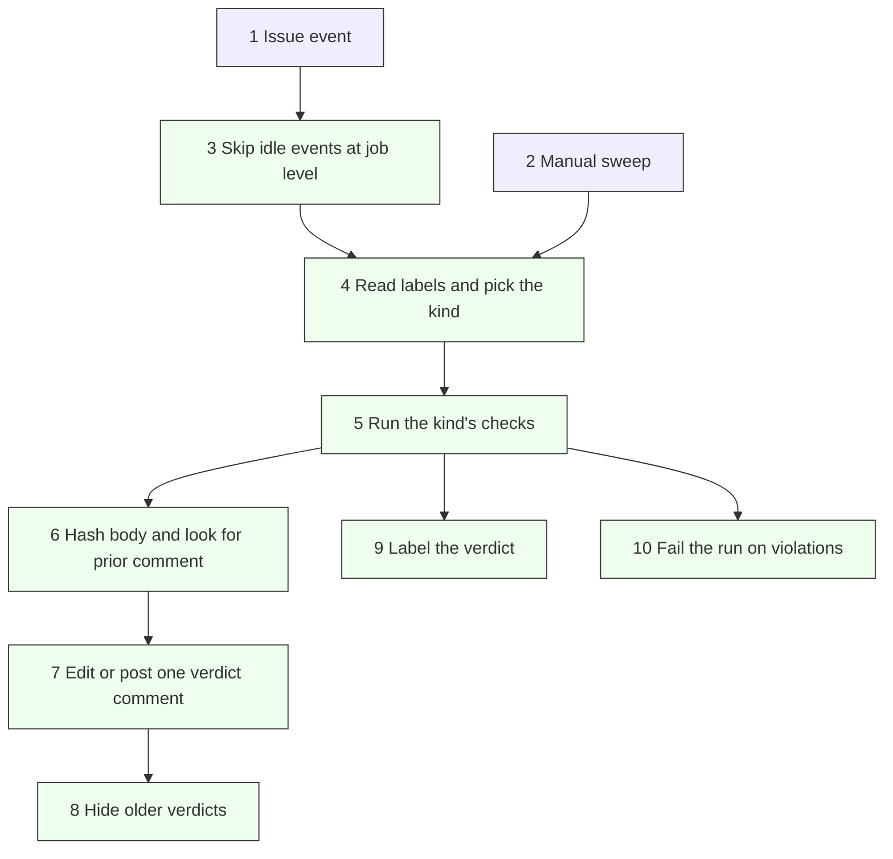
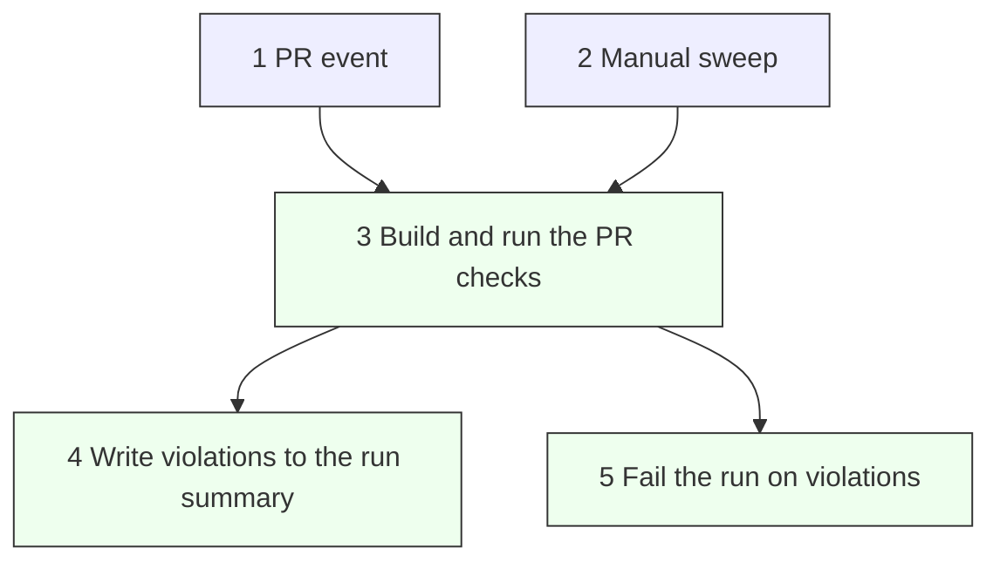
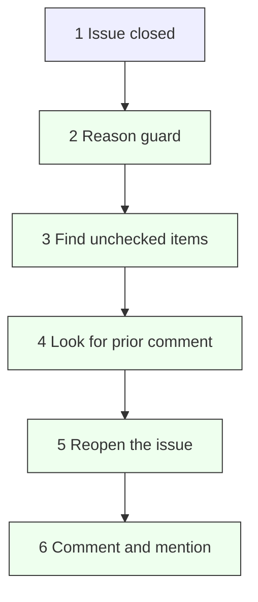
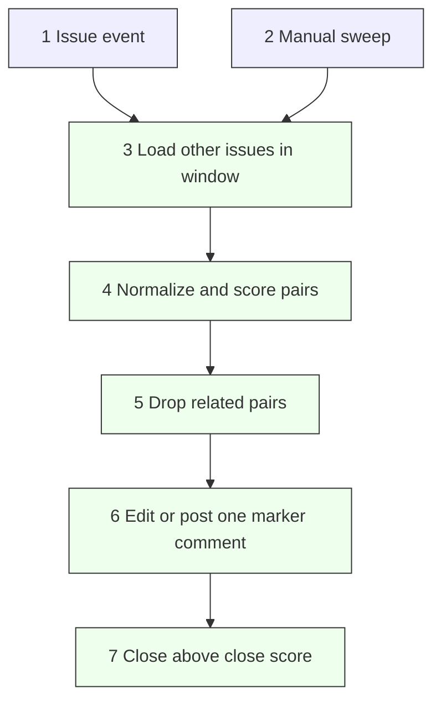
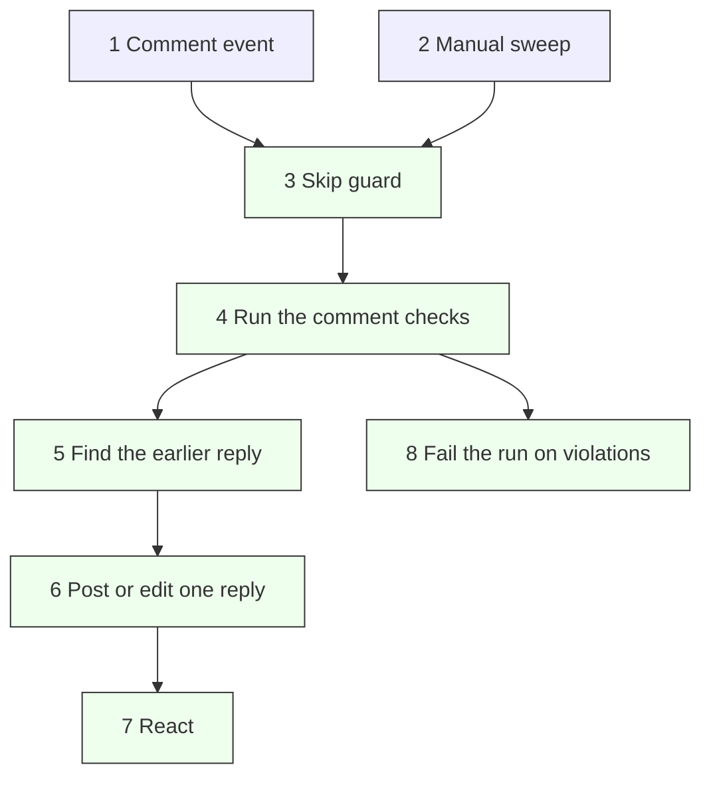
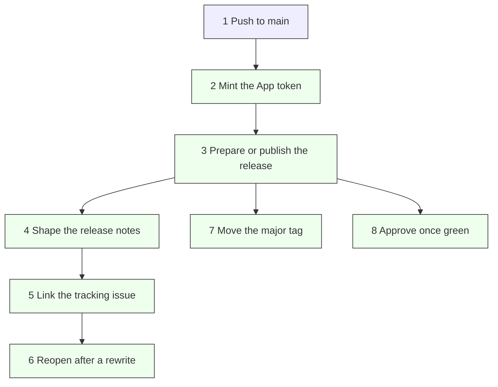

# Workflows

GitHub Actions workflows for this repo. The runner enforces the checks on commits; these workflows extend the same checks to places that are not files in the tree.

All workflows follow [ADR 0003](../../docs/architecture/adr/0003-native-github-workflow-feedback.md): native failure annotations, useful job summaries, and accurate source locations when available. Go commands share the reporter in `go/internal/report`. Each executable job has an always-run shell fallback for bootstrap failures.

Overflow reports are uploaded as `fitness-reports` artifacts with job, matrix, and attempt suffixes. Job summaries link to run logs; the run artifact list holds complete reports. Reports are retained for seven days. Pinned releases gain command details when upgraded; fallback reports cover their job outcomes now.

## Billing

Each started job bills at least one minute, though a check takes seconds, so run count drives spend. A job whose `if` is false starts no runner and bills nothing. So each issue, comment, and PR job skips events that cannot change its result. Its command skips them too.

Every Fitness job runs on `ubuntu-24.04-arm`, which GitHub bills at $0.005 a minute against $0.008 for x64 Linux, in private repos too. The fitness bundle, SwiftLint, Node and the JDK all ship arm64 builds, so the checks are the same. Only the release and distribution matrices keep an x64 leg, to test that platform's assets.

A per-issue or per-PR `concurrency` group cancels a superseded run, so a burst of edits ends in one verdict. issue-check queues instead, since only its opened run can close a duplicate, and GitHub keeps only the newest pending run.

## issue-check

Plans, Epics and other labeled kinds live as GitHub Issues, so the file runner never sees them. [issue-check.yml](issue-check.yml) runs `fitness issue-check` to lint an Issue body by its kind. It keeps one live verdict comment and label on the Issue. Other repos call [issue-check-reusable.yml](issue-check-reusable.yml).

Each `.github/ISSUE_TEMPLATE/*.md` in the checkout is a kind, keyed by its `labels` front matter. Its headings and pitch give the sections the body needs. A Plan also gets `plan-structure`, and an Epic gets `epic-structure` plus a match against its GitHub sub-issues. Any other kind needs only its template.



| #   | Element      | Description                                                        | Why                                                       |
| --- | ------------ | ----------------------------------------------------------------- | --------------------------------------------------------- |
| 1   | Issue event  | An Issue is opened, edited, reopened, or labeled.                 | Validates an issue the moment its description changes.     |
| 2   | Manual sweep | A `workflow_dispatch` run walks every open Issue with a kind label. | Backfills issues that predate the workflow.              |
| 3   | Skip guard   | Skip an edit that left the body alone, or a verdict label added; plan-check skips any label but `Plan`. | A skipped job bills nothing, and agents edit titles and labels often. |
| 4   | Kind         | Read the Issue's labels; no kind label passes, and two fail.      | Only labeled kinds have a template to meet.                |
| 5   | Run check    | Run the template shape, the kind's checks, and the doc checks.    | One tested binary, same rules as the local suite.          |
| 6   | Dedupe       | Hash the body and search the bot's comments for the kind's `fitness:issue-check:<kind>:` marker. | One comment per description version and kind; a pasted marker never counts. |
| 7   | Comment      | A pass after a pass edits it to `✅ Validated`; else post anew. | One live verdict, no pile of repeats. |
| 8   | Hide         | Hide older bot verdicts as outdated.                              | Only the live verdict stays open.                          |
| 9   | Label        | Add `fitness` and `fitness-valid` or `fitness-invalid`.          | Issue lists show the verdict.                              |
| 10  | Fail run     | Exit non-zero when any validated Issue has violations.            | Surfaces the problem in the Actions run, not just a note.  |

## Triggers

- `issues` (`opened`, `edited`, `reopened`, `labeled`): validates that one Issue by its kind label, and passes an Issue with none.
- Skipped: an `edited` event that changed neither title nor body, and a `labeled` event for a `fitness` verdict label.
- A title-only edit runs dupe-check alone, since issue-check judges only the body.
- `workflow_dispatch`: sweeps every open Issue with a kind label and comments on each body version not seen before.

A changed description earns a new verdict; earlier ones stay hidden. Plan verdicts posted under the earlier `fitness:plan-structure:` marker still count. Only the bot's own comments count; a run under another token sets `FITNESS_BOT_LOGIN` to that account.

## plan-check

[plan-check-reusable.yml](plan-check-reusable.yml) stays for repos whose caller still names it. It calls issue-check-reusable with the `plan-check` command, which is issue-check for Plan-labeled Issues only. This repo runs issue-check alone.

## pr-check

A PR description is not a file either, but a PR has a status check. So [pr-check.yml](pr-check.yml) does not comment. It runs `fitness pr-check` on the title and body and writes violations to the run summary. The run fails, so the red check blocks the merge.

In other repos the Fitness suite job runs pr-check, so the org ruleset's injected run of [pr-check-reusable.yml](pr-check-reusable.yml) skips without starting a runner. A repo's own caller of it still runs.



| #   | Element      | Description                                                  | Why                                                       |
| --- | ------------ | ----------------------------------------------------------- | --------------------------------------------------------- |
| 1   | PR event     | A PR is opened, edited, reopened, or synchronized.          | Validates a description the moment it changes.             |
| 2   | Manual sweep | A `workflow_dispatch` run walks every open PR.              | Audits every open description on demand.                   |
| 3   | Run check    | Run `fitness pr-check`, which also reads each closed issue's checklist. | One tested binary, same rules as the local suite.     |
| 4   | Summary      | Write each PR's result and its violations to the run summary. | The errors are visible on the run page, no thread noise.  |
| 5   | Fail run     | Exit non-zero when any validated PR has violations.         | A required status check blocks the merge, not just a note. |

## Triggers (pr-check)

- `pull_request` (`opened`, `edited`, `reopened`, `synchronize`): validates that one PR's description.
- `workflow_dispatch`: sweeps every open PR and reports each in the run summary.

There is no label guard: every PR has a description, so every PR is validated, and the status check is the verdict.

## Rerun a cancelled pr-check

Never close and reopen a PR to rerun one check: that reruns every workflow and drops auto-merge until the reopen run restores it. In other repos, pr-check runs from the org ruleset, so its workflow lives here. `gh run rerun <id>` first looks that workflow up in the PR's repo and gets a 404. Call GitHub's [re-run a workflow](https://docs.github.com/en/rest/actions/workflow-runs#re-run-a-workflow) endpoint directly instead:

```sh
gh api -X POST repos/<owner>/<repo>/actions/runs/<run-id>/rerun
```

The run id is in the check's details link, or in `gh api repos/<owner>/<repo>/actions/runs?branch=<head>` output. A rerun replays the original event, PR body included, so it suits a cancelled or flaky run. To check an edited body, push a commit before the owner approves.

## fitness-suite

A may-journal/.github ruleset injects [fitness-suite.yml](fitness-suite.yml) on every org pull request. It calls `ci-reusable`, which installs swiftlint when the checkout has Swift files. A job condition skips fitness-runner, which builds checks from source, without starting a runner.

With `pr-check: true` the same job then runs `fitness pr-check` on the PR's title and body, so a push starts one Fitness job, not two. An edit reruns the whole job, since it reports the same check on the same commit. `pr-check` findings still fail the job. The input defaults to off, since it needs `pull-requests` and `issues` read.

## close-check

[close-check.yml](close-check.yml) runs `fitness close-check` when an issue closes, so unfinished work stays open. Other repos call [close-check-reusable.yml](close-check-reusable.yml).



| #   | Element        | Description                                                         | Why                                                   |
| --- | -------------- | ------------------------------------------------------------------ | ----------------------------------------------------- |
| 1   | Issue closed   | An `issues: closed` event, from a person or a PR keyword.          | Catches every close.                                  |
| 2   | Reason guard   | A not planned or duplicate close skips at job level.               | Dropped work may stay unfinished.                     |
| 3   | Unchecked scan | List each `- [ ]` item, skipping any inside fenced code.           | Only real tasks count, not examples.                  |
| 4   | Dedupe         | Hash the close time and body, then look for that marker in the bot's comments. | A re-run never reopens or comments twice; a pasted marker never counts. |
| 5   | Reopen         | Set the Issue back to open.                                        | Unfinished work stays visible.                        |
| 6   | Comment        | List the items and mention the closer, PR author, and merger.      | The closer hears why it came back.                    |

## dupe-check

The issue-check job runs `fitness dupe-check` after its verdict when an issue opens or changes, so a repeat points to the first thread. One job per issue event bills one minute where a second dupe-check job billed two. [dupe-check-reusable.yml](dupe-check-reusable.yml) stays for repos whose caller still names it, and only answers a manual sweep.



| #   | Element      | Description                                                                 | Why                                                    |
| --- | ------------ | --------------------------------------------------------------------------- | ------------------------------------------------------ |
| 1   | Issue event  | An open Issue is opened, edited, or reopened, unless a known bot did it.    | Judges an issue the moment its text changes.           |
| 2   | Manual sweep | A `workflow_dispatch` run prints every pair's score and writes nothing.     | Tunes the scores on a repo's real issues first.        |
| 3   | Load         | List open issues and those closed within the window; drop bot-opened ones.  | Old closed work and templated bot issues add noise.    |
| 4   | Score        | Drop code, links, headings, and filler words, then compare the words.       | Word overlap fits small repos and needs no index.      |
| 5   | Related      | Skip parent and sub-issue pairs, sibling sub-issues, and issues one names.  | Planned structure is not a repeat.                     |
| 6   | Comment      | Above the warn score, keep one note listing the top three older matches.    | One note, edited in place, never a pile.               |
| 7   | Close        | On open only, at or above the close score, close as a duplicate.            | Off by default; a reopen by a person stands.           |

## Configuration (dupe-check)

The `.fitnessrc.json` `dupeCheck` key sets `warnScore` (0.4), `closeScore` (0, off), and `windowDays` (90). A score is the share of words two issues have in common, from 0 to 1. The close tier acts only when `closeScore` is above 0. close-check leaves an issue closed as a duplicate alone.

## comment-check

[comment-check.yml](comment-check.yml) runs `fitness comment-check` on each new or edited issue, PR, and review comment. Other repos call [comment-check-reusable.yml](comment-check-reusable.yml).

It judges every author but the known bots, which `KnownBots` in [comments.go](../../go/internal/metadata/comments.go) lists. Each job condition repeats the list, so a bot comment starts no runner. The optional `ignore-authors` input replaces that list; the login fitness posts as stays ignored.

Before posting, an agent runs `fitness comment-check --blob -` with the draft on stdin, or `--blob "<text>"`. It runs the same checks, prints each violation with its line, and exits 1 on any. The reply and the run summary point there too.



| #   | Element      | Description                                                                       | Why                                                  |
| --- | ------------ | --------------------------------------------------------------------------------- | ---------------------------------------------------- |
| 1   | Comment event | An issue comment, a submitted review, or an edited comment.                      | Judges a comment the moment its text changes.        |
| 2   | Manual sweep | A `workflow_dispatch` run walks the last seven days of comments.                  | Audits comments that predate the workflow.           |
| 3   | Skip guard   | Skip the known bots at job level, which post every fitness verdict and reply.     | Every person and agent owns what they wrote.         |
| 4   | Run checks   | Run `comment-structure`, `mermaid-syntax`, and the Plan and PR prose checks.      | One tested rule set, the same one agents run first.  |
| 5   | Dedupe       | Find the bot's reply whose marker names this comment's id.                        | One reply per comment, never a pile.                 |
| 6   | Reply        | Mention the author with the violations, or turn the reply into a passing note.    | The author hears what to fix, and sees it cleared.   |
| 7   | React        | Add a thumbs-down to a failing comment and remove it once it passes.              | The thread shows which comment needs work.           |
| 8   | Fail run     | Exit non-zero when any judged comment has violations.                             | The run page and summary list every violation.       |

## Triggers (comment-check)

- `issue_comment` (`created`, `edited`) and `pull_request_review_comment` (`edited`): judge that one comment; a review reply answers in its thread.
- `pull_request_review` (`submitted`): judges all of that review's comments in one run, replying in each failing thread.
- One job per review bills one minute, where a job per review comment billed a minute each.
- `workflow_dispatch`: sweeps recent comments; `FITNESS_SWEEP_DAYS` changes the seven-day window.

A comment that always passed gets no reply. The `.fitnessrc.json` `comment` key sets `maxWords` (100) and `maxTables` (1).

## setup-go-cache

Every workflow here that needs Go uses the local [setup-go-cache](../actions/setup-go-cache/action.yml) action. It installs the Go version `go/go.mod` names, with setup-go's cache off, since no `go.sum` exists. Jobs that only build `./cmd/...` pass no cache family and build cold in seconds.

The others restore `~/.cache/go-build` under `go-build-<family>-<os>-<arch>-go<version>-<hash of go/>`. A miss falls back only to that family, arch, and Go version.

| Family       | Saved by                                 | Restored by                        |
| ------------ | ---------------------------------------- | ---------------------------------- |
| fitness      | ci.yml `fitness`                         | `fitness`                          |
| bundle       | distribution.yml `bundle`                | `bundle`                           |
| smoke        | distribution.yml `smoke`                 | `smoke`, Release `verify-download` |
| requirements | distribution.yml `requirements`, shard 1 | `requirements`                     |

Only a push to `main` saves, when the job passes `save: true`. Pull requests restore main's caches but never save, so they cannot evict main's under the 10 GB limit. Binary distribution runs on main pushes that touch Go or GoReleaser files, to save its caches.

### In other repos

Reusable workflows run in other repos, which have no `go.sum` either, so their setup-go cache is off. ci-reusable instead installs the Go the repo's `go.mod` names and caches `~/.cache/go-build` itself. Its key holds the platform, Go version and a hash of the Go sources. It saves on pull requests, since the suite runs on nothing else, so a PR's next push compiles only what changed.

## auto-merge

[auto-merge.yml](auto-merge.yml) turns on squash auto-merge for ready pull requests in every org repo, as a required workflow. It lives here because public repos cannot run a private repo's workflows. It acts as the `may-journal-automation` App, so CI still runs on `main`.

may-journal/.github syncs [auto-merge-on-ready.yml](auto-merge-on-ready.yml) into each repo, so drafts marked ready and approvals get it. The org's copy also runs it when a PR's base changes. The job runs only for an open, ready PR without auto-merge, so other pushes start no runner and bill nothing. A reopen always runs it, since closing a PR turns its [auto-merge](https://docs.github.com/en/pull-requests/collaborating-with-pull-requests/incorporating-changes-from-a-pull-request/automatically-merging-a-pull-request) off.

### Stacks

GitHub has no auto-merge for a [stacked PR](https://docs.github.com/en/pull-requests/how-tos/merge-and-close-pull-requests/merging-stacked-pull-requests), so the job merges a native stack from `gh stack` itself. Once every PR in it is approved, green and mergeable, it [merges the top PR asynchronously](https://docs.github.com/en/rest/pulls/pulls?apiVersion=2026-03-10#merge-a-pull-request-asynchronously). That lands the PRs below it, and each PR gets a comment saying what merged or what waits. Any refusal or failed merge turns the job red with GitHub's answer.

The job runs on each push and on each approval of a branch in the repo, never when checks finish. So a stack approved before its checks pass waits for the next approval or push.

The job never pushes, rebases or bypasses rules, so it never dismisses an approval. So it cannot merge a branch chain, a PR based on another PR's branch with no stack. Merging a child pushes to its parent, which [dismisses stale approvals](https://docs.github.com/en/repositories/configuring-branches-and-merges-in-your-repository/managing-rulesets/available-rules-for-rulesets#require-a-pull-request-before-merging). Such a PR gets one comment saying why, and gets auto-merge once GitHub moves it onto the default branch.

## release-please

[release-please-reusable.yml](release-please-reusable.yml) runs Release Please for every repo that opts in to releases. may-journal/.github syncs a short caller into each one, which runs on pushes to `main` and passes `secrets: inherit`. Each repo keeps its own `release-please-config.json`, manifest, and `version.txt`. This repo releases through its own CI and Release workflows instead.



| #   | Element       | Description                                                            | Why                                                   |
| --- | ------------- | ---------------------------------------------------------------------- | ----------------------------------------------------- |
| 1   | Push to main  | The caller runs on each push to `main`, one run at a time per repo.    | Each merge updates the release PR.                    |
| 2   | App token     | Check the App secrets, then mint a `may-journal-automation` token.     | GitHub starts no workflows from GITHUB_TOKEN changes. |
| 3   | Release       | Release Please keeps a release PR open, or tags and publishes it once merged. | Versions come from conventional commits.       |
| 4   | Shape         | Demote each `##` heading under `## Changelog` and strip bold scopes.   | pr-check wants plain bullets under `## Changelog`.    |
| 5   | Link          | Find or open the tracking issue by title, and close it from the PR.   | pr-check needs every PR to close an issue.            |
| 6   | Reopen        | Close and reopen the PR after either rewrite.                          | pr-check does not run on a body edit.                 |
| 7   | Major tag     | Point `vX` at the new release.                                         | Consumers pin the major version.                      |
| 8   | Approve       | [release-approve.yml](#release-approve) approves the open release PR once green. | The ruleset needs one approval.          |

Steps 4 to 6 and 8 skip when Release Please leaves no PR open. Step 7 runs only for a new release.

## release-approve

[release-approve.yml](release-approve.yml) approves a green Release Please PR, so it merges without a person approving it ([#523](https://github.com/may-journal/fitness-runner/issues/523)). The org ruleset needs one approval, and an author cannot [approve its own PR](https://docs.github.com/en/pull-requests/collaborating-with-pull-requests/reviewing-changes-in-pull-requests/approving-a-pull-request-with-required-reviews). So the approver, a machine user, approves what `may-journal-automation` opens, as only write-access approvals count toward the required one ([.github#125](https://github.com/may-journal/.github/issues/125)). [release-please-reusable.yml](release-please-reusable.yml) and this repo's CI call it after each run that leaves a release PR open.

It approves only when all of these hold, and otherwise leaves the PR for a person with a notice saying why:

- The PR's author is `may-journal-automation`, and the PR is open and ready.
- Every changed path is `CHANGELOG.md`, `version.txt` or `.release-please-manifest.json`, counting both paths of a rename.
- Every check but this run's own passes or skips within 20 minutes, polled every 30 seconds, and the head has not moved.

The approval names the commit it checked, so the ruleset dismisses it on a later push and the next run approves anew. Without the `APPROVER_TOKEN` secret the approval skips with a notice; a rejected token, or one that cannot see the repo, fails at once. That secret is the approver's fine-grained token with pull request read and write, used only to read reviews and approve. The run's own token reads the PR, its files and checks, so each calling job grants `contents`, `pull-requests`, `checks` and `statuses` read.

### Dependency bumps

With `kind: dependency`, it approves a green `build(deps)` PR that only bumps dev dependencies ([#524](https://github.com/may-journal/fitness-runner/issues/524)). Its files must be `package.json` and `package-lock.json` alone. Against the merge base, `package.json` may change only existing `devDependencies`, and the lockfile only `dev` packages from the npm registry. Each moved version keeps its major number, or its minor below 1.0, so runtime and major bumps stay with a person.

A repo opts in with a caller that runs on its pull requests, as in this sketch:

```yaml
on:
  pull_request:
    types: [opened, reopened, synchronize, ready_for_review]
jobs:
  approve:
    if: ${{ startsWith(github.event.pull_request.title, 'build(deps)') }}
    permissions:
      contents: read
      pull-requests: read
      checks: read
      statuses: read
    uses: may-journal/fitness-runner/.github/workflows/release-approve.yml@v1
    with:
      pr: ${{ github.event.pull_request.number }}
      kind: dependency
    secrets: inherit
```
