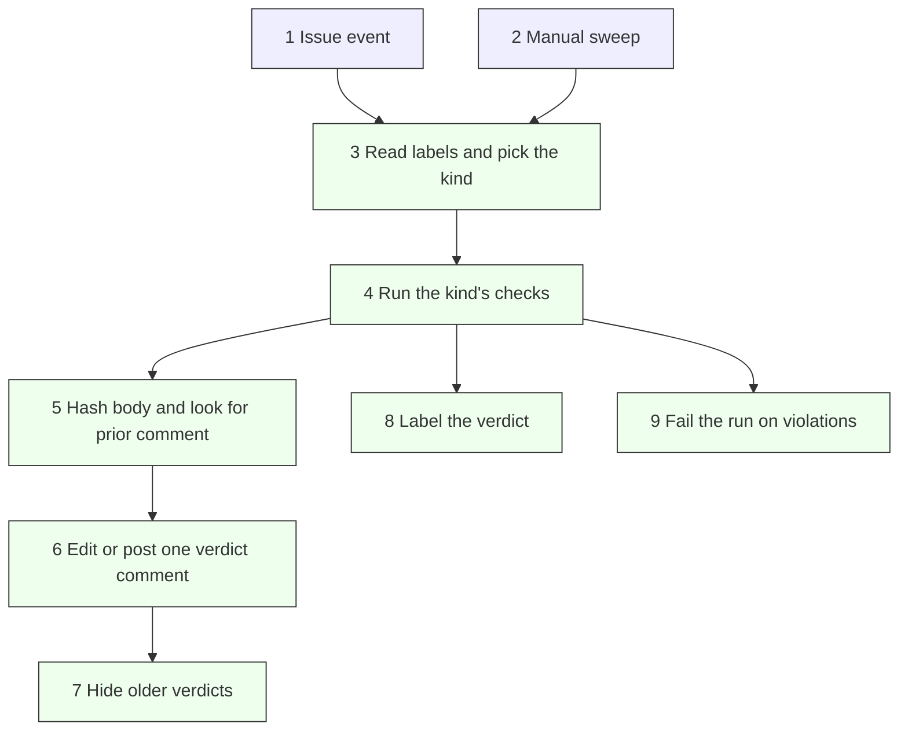
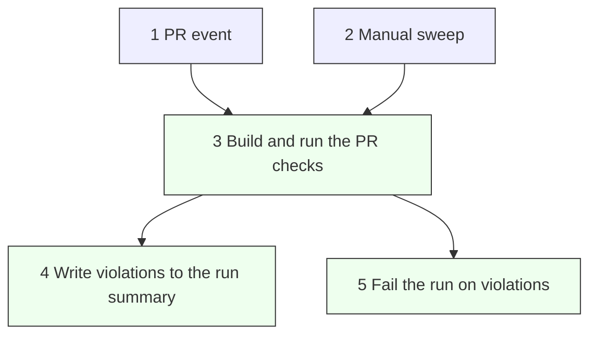
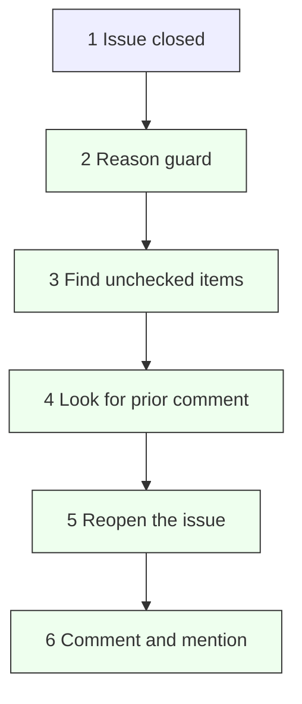
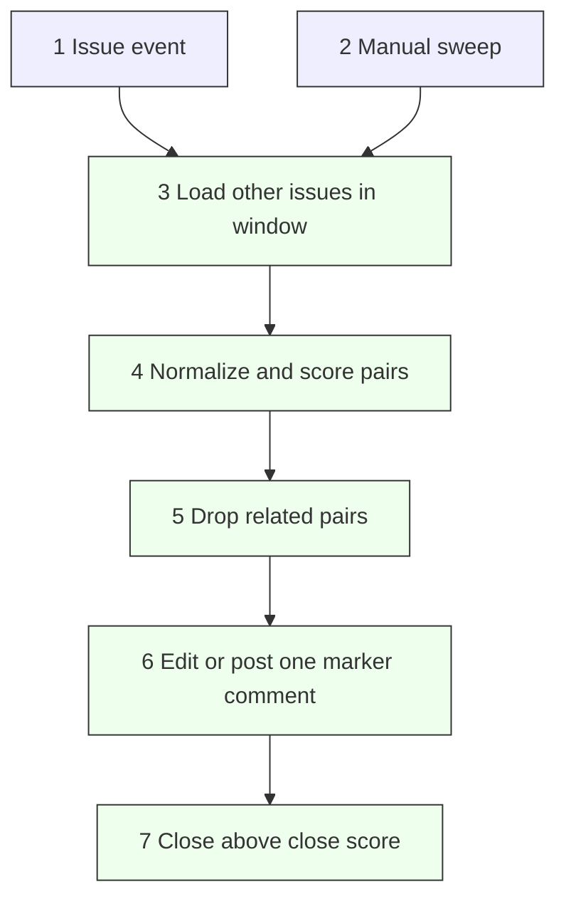
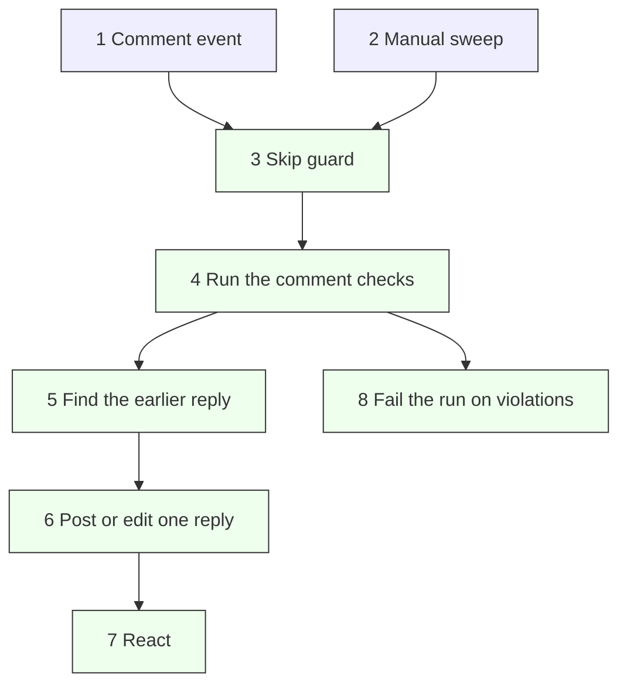

# Workflows

GitHub Actions workflows for this repo. The runner enforces the checks on commits; these workflows extend the same checks to places that are not files in the tree.

All workflows follow [ADR 0003](../../docs/architecture/adr/0003-native-github-workflow-feedback.md): native failure annotations, useful job summaries, and accurate source locations when available. Go commands share the reporter in `go/internal/report`. Each executable job has an always-run shell fallback for bootstrap failures.

Overflow reports are uploaded as `fitness-reports` artifacts with job, matrix, and attempt suffixes. Job summaries link to run logs; the run artifact list holds complete reports. Reports are retained for seven days. Pinned releases gain command details when upgraded; fallback reports cover their job outcomes now.

## issue-check

Plans, Epics and other labeled kinds live as GitHub Issues, so the file runner never sees them. [issue-check.yml](issue-check.yml) runs `fitness issue-check` to lint an Issue body by its kind. It keeps one live verdict comment and label on the Issue. Other repos call [issue-check-reusable.yml](issue-check-reusable.yml).

Each `.github/ISSUE_TEMPLATE/*.md` in the checkout is a kind, keyed by its `labels` front matter. Its headings and pitch give the sections the body needs. A Plan also gets `plan-structure`, and an Epic gets `epic-structure` plus a match against its GitHub sub-issues. Any other kind needs only its template.

| #   | Element      | Description                                                        | Why                                                       |
| --- | ------------ | ----------------------------------------------------------------- | --------------------------------------------------------- |
| 1   | Issue event  | An Issue is opened, edited, reopened, or labeled.                 | Validates an issue the moment its description changes.     |
| 2   | Manual sweep | A `workflow_dispatch` run walks every open Issue with a kind label. | Backfills issues that predate the workflow.              |
| 3   | Kind         | Read the Issue's labels; no kind label passes, and two fail.      | Only labeled kinds have a template to meet.                |
| 4   | Run check    | Run the template shape, the kind's checks, and the doc checks.    | One tested binary, same rules as the local suite.          |
| 5   | Dedupe       | Hash the body and search the bot's comments for the kind's `fitness:issue-check:<kind>:` marker. | One comment per description version and kind; a pasted marker never counts. |
| 6   | Comment      | A pass after a pass edits it to `✅ Validated`; else post anew. | One live verdict, no pile of repeats. |
| 7   | Hide         | Hide older bot verdicts as outdated.                              | Only the live verdict stays open.                          |
| 8   | Label        | Add `fitness` and `fitness-valid` or `fitness-invalid`.          | Issue lists show the verdict.                              |
| 9   | Fail run     | Exit non-zero when any validated Issue has violations.            | Surfaces the problem in the Actions run, not just a note.  |

## Triggers

- `issues` (`opened`, `edited`, `reopened`, `labeled`): validates that one Issue by its kind label, and passes an Issue with none.
- `workflow_dispatch`: sweeps every open Issue with a kind label and comments on each body version not seen before.

A changed description earns a new verdict; earlier ones stay hidden. Plan verdicts posted under the earlier `fitness:plan-structure:` marker still count. Only the bot's own comments count; a run under another token sets `FITNESS_BOT_LOGIN` to that account.

## plan-check

[plan-check-reusable.yml](plan-check-reusable.yml) stays for repos whose caller still names it. It calls issue-check-reusable with the `plan-check` command, which is issue-check for Plan-labeled Issues only. This repo runs issue-check alone.

## pr-check

A PR description is not a file either, but a PR has a status check. So [pr-check.yml](pr-check.yml) does not comment. It runs `fitness pr-check` on the title and body and writes violations to the run summary. The run fails, so the red check blocks the merge.

| #   | Element      | Description                                                  | Why                                                       |
| --- | ------------ | ----------------------------------------------------------- | --------------------------------------------------------- |
| 1   | PR event     | A PR is opened, edited, reopened, or synchronized.          | Validates a description the moment it changes.             |
| 2   | Manual sweep | A `workflow_dispatch` run walks every open PR.              | Audits every open description on demand.                   |
| 3   | Run check    | Run `fitness pr-check`, which also reads each closed issue's checklist. | One tested binary, same rules as the local suite.     |
| 4   | Summary      | Write each PR's result and its violations to the run summary. | The errors are visible on the run page, no thread noise.  |
| 5   | Fail run     | Exit non-zero when any validated PR has violations.         | A required status check blocks the merge, not just a note. |

## Triggers (pr-check)

- `pull_request` (`opened`, `edited`, `reopened`, `synchronize`): validates that one PR's description.
- `workflow_dispatch`: sweeps every open PR and reports each in the run summary.

There is no label guard: every PR has a description, so every PR is validated, and the status check is the verdict.

## fitness-suite

A may-journal/.github ruleset injects [fitness-suite.yml](fitness-suite.yml) on every org pull request, as it does pr-check. It calls `ci-reusable`, which installs swiftlint when the checkout has Swift files. A job condition skips fitness-runner, which builds checks from source, without starting a runner.

## close-check

[close-check.yml](close-check.yml) runs `fitness close-check` when an issue closes, so unfinished work stays open. Other repos call [close-check-reusable.yml](close-check-reusable.yml).

| #   | Element        | Description                                                         | Why                                                   |
| --- | -------------- | ------------------------------------------------------------------ | ----------------------------------------------------- |
| 1   | Issue closed   | An `issues: closed` event, from a person or a PR keyword.          | Catches every close.                                  |
| 2   | Reason guard   | A not planned or duplicate close stops here.                       | Dropped work may stay unfinished.                     |
| 3   | Unchecked scan | List each `- [ ]` item, skipping any inside fenced code.           | Only real tasks count, not examples.                  |
| 4   | Dedupe         | Hash the close time and body, then look for that marker in the bot's comments. | A re-run never reopens or comments twice; a pasted marker never counts. |
| 5   | Reopen         | Set the Issue back to open.                                        | Unfinished work stays visible.                        |
| 6   | Comment        | List the items and mention the closer, PR author, and merger.      | The closer hears why it came back.                    |

## dupe-check

[dupe-check.yml](dupe-check.yml) runs `fitness dupe-check` when an issue opens or changes, so a repeat points to the first thread. Other repos call [dupe-check-reusable.yml](dupe-check-reusable.yml).

| #   | Element      | Description                                                                 | Why                                                    |
| --- | ------------ | --------------------------------------------------------------------------- | ------------------------------------------------------ |
| 1   | Issue event  | An open Issue is opened, edited, or reopened, unless a known bot did it.    | Judges an issue the moment its text changes.           |
| 2   | Manual sweep | A `workflow_dispatch` run prints every pair's score and writes nothing.     | Tunes the scores on a repo's real issues first.        |
| 3   | Load         | List open issues and those closed within the window; drop bot-opened ones.  | Old closed work and templated bot issues add noise.    |
| 4   | Score        | Drop code, links, headings, and filler words, then compare the words.       | Word overlap fits small repos and needs no index.      |
| 5   | Related      | Skip parent and sub-issue pairs, sibling sub-issues, and issues one names.  | Planned structure is not a repeat.                     |
| 6   | Comment      | Above the warn score, keep one note listing the top three older matches.    | One note, edited in place, never a pile.               |
| 7   | Close        | On open only, at or above the close score, close as a duplicate.            | Off by default; a reopen by a person stands.           |

## Configuration (dupe-check)

The `.fitnessrc.json` `dupeCheck` key sets `warnScore` (0.4), `closeScore` (0, off), and `windowDays` (90). A score is the share of words two issues have in common, from 0 to 1. The close tier acts only when `closeScore` is above 0. close-check leaves an issue closed as a duplicate alone.

## comment-check

[comment-check.yml](comment-check.yml) runs `fitness comment-check` on each new or edited issue, PR, and review comment. Other repos call [comment-check-reusable.yml](comment-check-reusable.yml). It judges every author but the known bots, which `KnownBots` in [comments.go](../../go/internal/metadata/comments.go) lists once. The optional `ignore-authors` input replaces that list; the login fitness posts as stays ignored.

Before posting, an agent runs `fitness comment-check --blob -` with the draft on stdin, or `--blob "<text>"`. It runs the same checks, prints each violation with its line, and exits 1 on any. The reply and the run summary point there too.

| #   | Element      | Description                                                                       | Why                                                  |
| --- | ------------ | --------------------------------------------------------------------------------- | ---------------------------------------------------- |
| 1   | Comment event | An issue, PR, or review comment is created or edited.                            | Judges a comment the moment its text changes.        |
| 2   | Manual sweep | A `workflow_dispatch` run walks the last seven days of comments.                  | Audits comments that predate the workflow.           |
| 3   | Skip guard   | Skip the known bots, which post every fitness verdict and reply.                  | Every person and agent owns what they wrote.         |
| 4   | Run checks   | Run `comment-structure`, `mermaid-syntax`, and the Plan and PR prose checks.      | One tested rule set, the same one agents run first.  |
| 5   | Dedupe       | Find the bot's reply whose marker names this comment's id.                        | One reply per comment, never a pile.                 |
| 6   | Reply        | Mention the author with the violations, or turn the reply into a passing note.    | The author hears what to fix, and sees it cleared.   |
| 7   | React        | Add a thumbs-down to a failing comment and remove it once it passes.              | The thread shows which comment needs work.           |
| 8   | Fail run     | Exit non-zero when any judged comment has violations.                             | The run page and summary list every violation.       |

## Triggers (comment-check)

- `issue_comment` and `pull_request_review_comment` (`created`, `edited`): judge that one comment; a review reply answers in its thread.
- `workflow_dispatch`: sweeps recent comments; `FITNESS_SWEEP_DAYS` changes the seven-day window.

A comment that always passed gets no reply. The `.fitnessrc.json` `comment` key sets `maxWords` (100) and `maxTables` (1).

## setup-go-cache

Every workflow here that needs Go uses the local [setup-go-cache](../actions/setup-go-cache/action.yml) action. It installs the Go version `go/go.mod` names, with setup-go's cache off, since no `go.sum` exists. Jobs that only build `./cmd/...` pass no cache family and build cold in seconds.

The others restore `~/.cache/go-build` under `go-build-<family>-<os>-<arch>-go<version>-<hash of go/>`. A miss falls back only to that family, arch, and Go version.

| Family  | Saved by                  | Restored by                         |
| ------- | ------------------------- | ----------------------------------- |
| fitness | ci.yml `fitness`          | `fitness`                           |
| bundle  | distribution.yml `bundle` | `bundle`                            |
| smoke   | distribution.yml `smoke`  | `smoke`, Release `verify-download`  |

Only a push to `main` saves, when the job passes `save: true`. Pull requests restore main's caches but never save, so they cannot evict main's under the 10 GB limit. Binary distribution runs on main pushes that touch Go or GoReleaser files, to save its caches. Reusable workflows run in other repos, which have no `go.sum` either, so their setup-go cache is off.

## auto-merge

[auto-merge.yml](auto-merge.yml) turns on squash auto-merge for ready pull requests in every org repo, as a required workflow. It lives here because public repos cannot run a private repo's workflows. It acts as the `may-journal-automation` App, so CI still runs on `main`.

may-journal/.github syncs [auto-merge-on-ready.yml](auto-merge-on-ready.yml) into each repo, so drafts marked ready get it.
