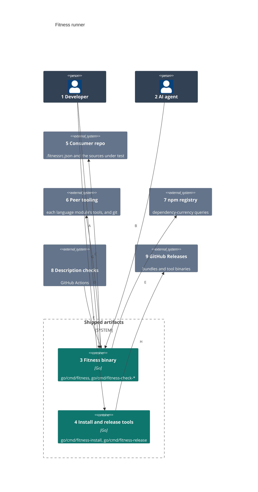
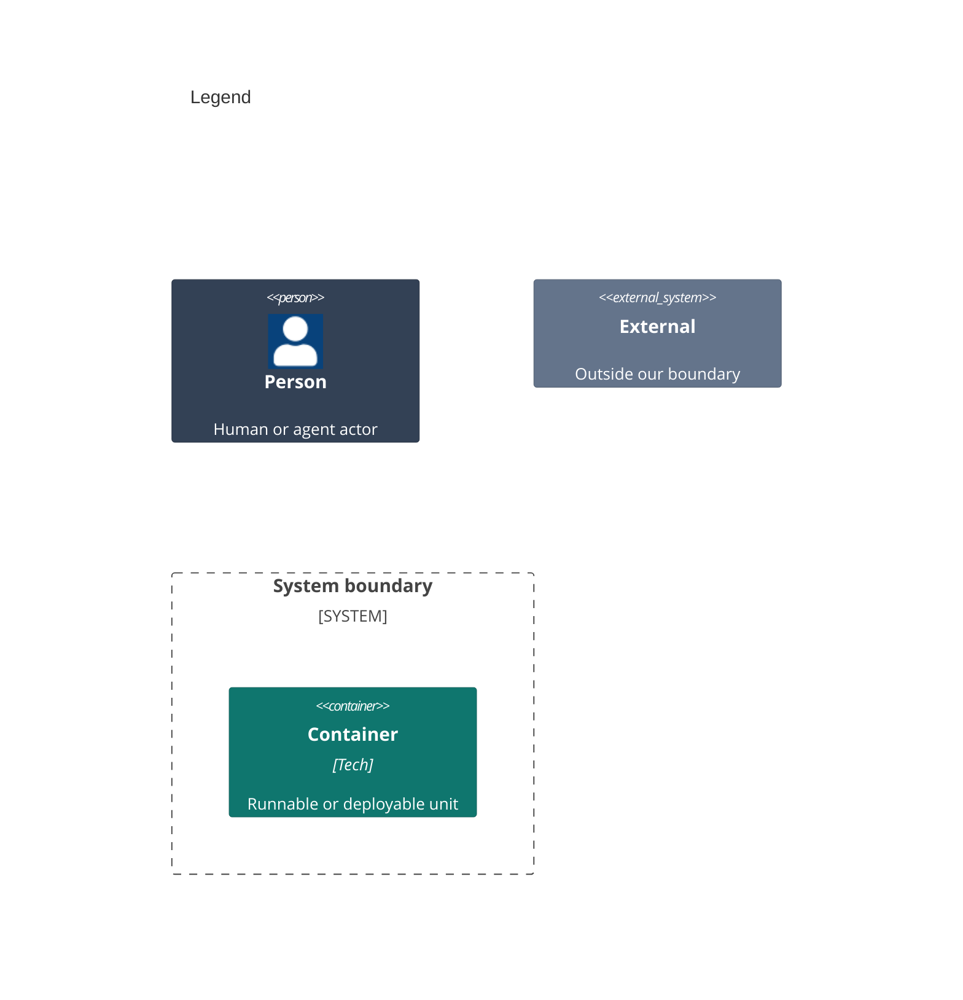

# Containers

Numbers on nodes and letters on arrows match the callout table. Each container names the commands it is built from; a trailing `*` names every sibling folder.

| #   | Description                                                                                      | Why                                                         |
| --- | ------------------------------------------------------------------------------------------------ | ----------------------------------------------------------- |
| 1   | Same actor as system context.                                                                    | All runs start at the fitness binary.                       |
| 2   | Same agent actor as system context.                                                              | Agents never link checks — they invoke the CLI.             |
| 3   | `fitness` — the runner and every check. It runs each check as its own process, started as `fitness-check-<name>`. | One file to ship and load; checks still cannot share state. |
| 4   | The installer and the release tool.                                                              | Shipped beside the bundle; not part of any run.             |
| 5   | Optional `.fitnessrc.json` with per-check options, and the files checks lint, format, or scan.   | Every check runs on every tracked file; no path is ignored. |
| 6   | Tool-wrapper checks exec these when installed; native engines (cspell, jscpd souls) need none.   | Peer tools resolved at runtime, never bundled.              |
| 7   | The dependency-currency check queries the registry over HTTPS directly.                          | No npm binary needed; offline degrades to pass.             |
| 8   | The `issue-check` and `pr-check` GitHub Actions workflows lint an Issue or PR description.       | Descriptions held to the same bar as files.                 |
| 9   | Release bundles and tool binaries, one archive per platform holding the one fitness binary.      | Artifacts ship through GitHub Releases and the Go proxy.    |
| A   | Developer runs the binary from the consumer root.                                                | One front door.                                             |
| B   | Agent runs the same binary via script or hook.                                                   | Unified enforcement path.                                   |
| C   | The runner loads `.fitnessrc.json`, and each check process reads the tree, staged or full.        | Config and validation target live with the app.             |
| D   | Checks resolve peer binaries the way their language module finds tools, then PATH.               | Missing tools fail with one-line install hints.             |
| E   | Abbreviated registry metadata, configured registry honored from .npmrc.                          | Currency judgment without shelling to npm.                  |
| F   | `fitness pr-check` and `issue-check` run each check with `--body-file`, reusing body mode.       | One rule engine for files and descriptions.                 |
| G   | Developer runs `fitness-install`; the pre-commit hook runs the suite.                            | One documented one-liner installs or runs the suite.        |
| H   | `fitness-release` builds and publishes the bundles.                                              | Release and install share one versioned artifact set.       |

## Consumer setup

| Setup                           | Config         | What runs                                         |
| ------------------------------- | -------------- | ------------------------------------------------- |
| Fitness binary on PATH          | None           | Every check; one that does not apply passes clean |
| Above + per-check options       | Tune one check | Every check, the tuned one with your options      |

There is no list of checks to keep in sync: each check detects whether its language, tool, config, or input is present. A leftover `checks` key is ignored with a one-line warning. The cspell and jscpd checks are native engines needing no external tool. A language module's tool-wrapper checks exec the real tool and fail clearly when it is missing.

Install and usage: [README.md](../../README.md). Artifacts ship through GitHub Releases and the public Go module proxy — see the README's Distribution section.
