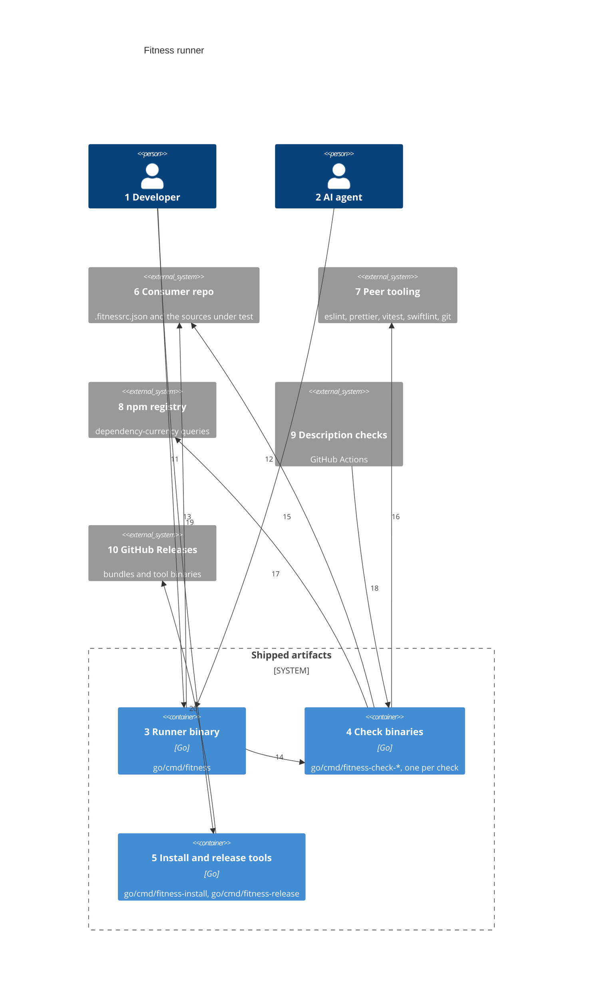
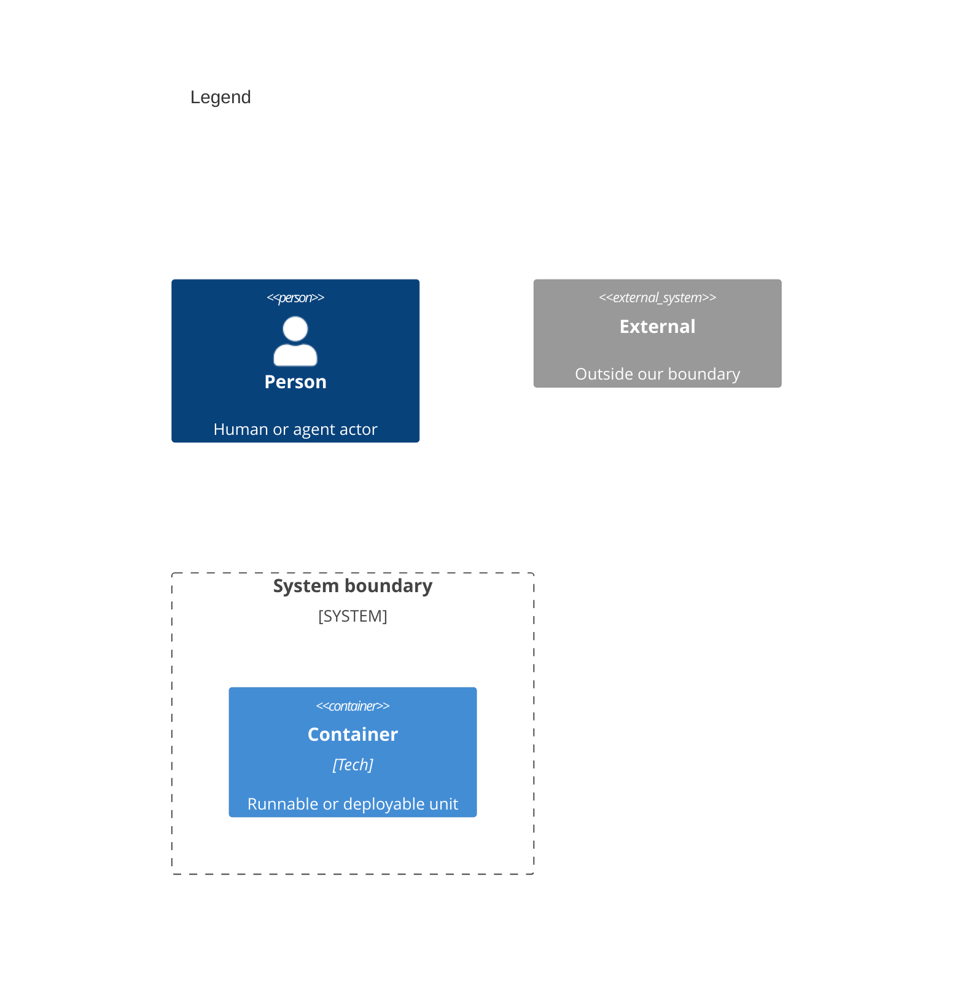

# Containers

Numbers on nodes and arrows match the callout table. Each container names the Go commands it is built from; a trailing `*` names every sibling folder.

| #   | Description                                                                                      | Why                                                         |
| --- | ------------------------------------------------------------------------------------------------ | ----------------------------------------------------------- |
| 1   | Same actor as system context.                                                                    | All runs start at the runner binary.                        |
| 2   | Same agent actor as system context.                                                              | Agents never link checks — they invoke the CLI.             |
| 3   | `fitness` — argv, spec resolution, describe handshake, parallel pool, results table.             | Single orchestration surface, one static binary.            |
| 4   | One static binary per check name, found beside the runner then on PATH.                          | Plugin model at the artifact level; no in-process registry. |
| 5   | The installer and the release tool.                                                              | Shipped beside the checks; not part of any run.             |
| 6   | Optional `.fitnessrc.json` with per-check options, and the files checks lint, format, or scan.   | Every check runs on every tracked file; no path is ignored. |
| 7   | Tool-wrapper checks exec these when installed; native engines (cspell, jscpd souls) need none.   | Peer tools resolved at runtime, never bundled.              |
| 8   | The dependency-currency check queries the registry over HTTPS directly.                          | No npm binary needed; offline degrades to pass.             |
| 9   | The `plan-check` and `pr-check` GitHub Actions workflows lint an Issue or PR description.        | Descriptions held to the same bar as files.                 |
| 10  | Release bundles and tool binaries, one archive per platform.                                     | Artifacts ship through GitHub Releases and the Go proxy.    |
| 11  | Developer runs the binary from the consumer root.                                                | One front door.                                             |
| 12  | Agent runs the same binary via script or hook.                                                   | Unified enforcement path.                                   |
| 13  | Runner loads `.fitnessrc.json` from the consumer root.                                           | Config lives with the app, not the runner source.           |
| 14  | Runner execs `fitness-check-name --root dir` per resolved name.                                  | Runtime resolution — no static registry in the runner.      |
| 15  | Checks read the consumer tree (staged or full).                                                  | Validation target is always the app repo.                   |
| 16  | Checks resolve peer binaries from `node_modules/.bin` walking up, then PATH, never npx.          | Missing tools fail with one-line install hints.             |
| 17  | Abbreviated registry metadata, configured registry honored from .npmrc.                          | Currency judgment without shelling to npm.                  |
| 18  | `fitness pr-check` and `plan-check` exec each check with `--body-file`, reusing body mode.       | One rule engine for files and descriptions.                 |
| 19  | Developer runs `fitness-install`; the pre-commit hook runs the suite.                           | One documented one-liner installs or runs the suite.        |
| 20  | `fitness-release` builds and publishes the bundles.                                              | Release and install share one versioned artifact set.       |

## Consumer setup

| Setup                           | Config         | What runs                                         |
| ------------------------------- | -------------- | ------------------------------------------------- |
| Runner + check binaries on PATH | None           | Every check; one that does not apply passes clean |
| Above + per-check options       | Tune one check | Every check, the tuned one with your options      |

There is no list of checks to keep in sync: each check detects whether its language, tool, config, or input is present. A leftover `checks` key is ignored with a one-line warning. The cspell and jscpd checks are native engines needing no external tool. Prettier, eslint, vitest-coverage-full, and swiftlint exec the real tool and fail clearly when it is missing.

Install and usage: [README.md](../../README.md). Artifacts ship through GitHub Releases and the public Go module proxy — see the README's Distribution section.
