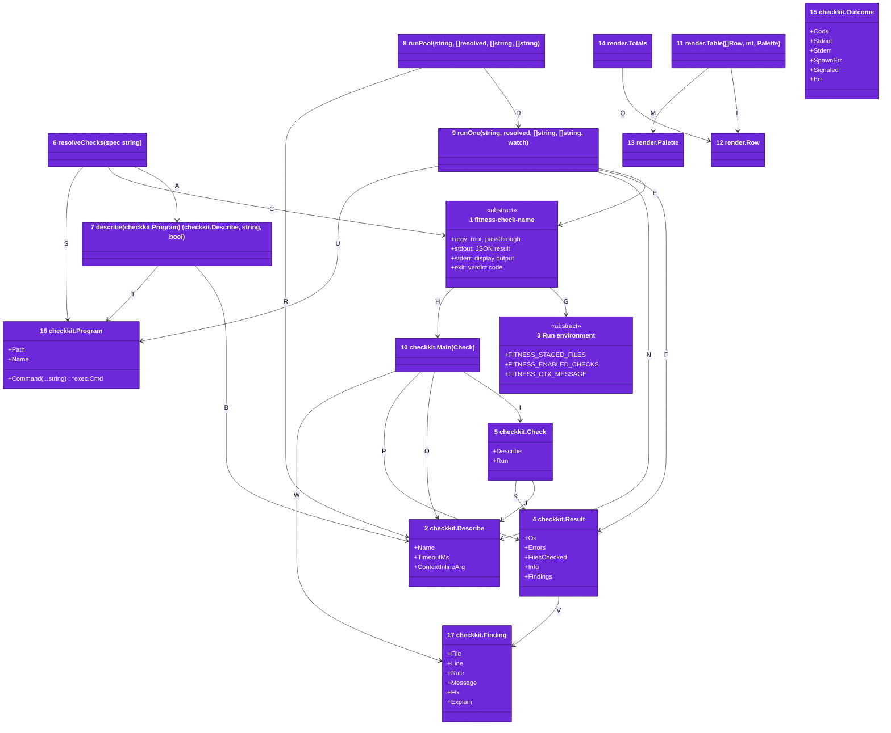
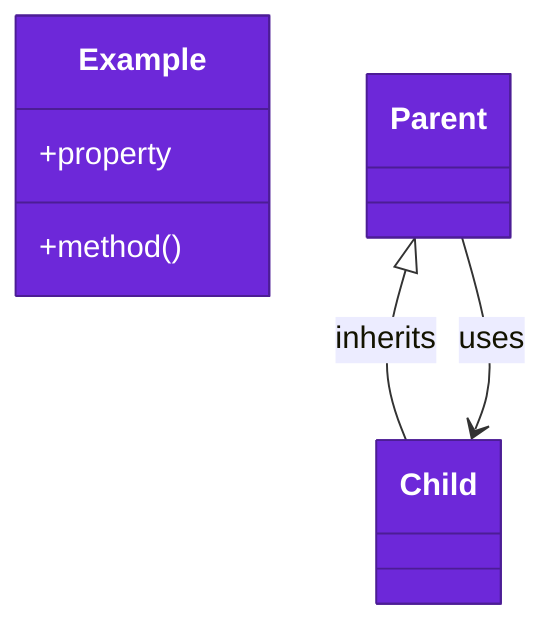

# Code





Numbers on classes and letters on relationships match the callout table.

| #   | Description | Why |
| --- | ----------- | --- |
| 1   | The check contract: `fitness-check-name --root dir [args…]`, JSON result on stdout. | Every check is one program name; built-in ones share the fitness binary. |
| 2   | Metadata a check prints for `--describe`, in [checkkit.go](../../go/internal/checkkit/checkkit.go): name, timeout budget, context-inline argument. | The runner discovers capabilities with a handshake, not a registry. |
| 3   | Environment the runner exports before dispatch. | Checks stay stateless; context flows one way. |
| 4   | `{Ok, Errors, FilesChecked, Info, Findings}`, in [checkkit.go](../../go/internal/checkkit/checkkit.go): emitted by the check, parsed by the runner. | Aggregated into the results table. |
| 5   | One check in [checkkit.go](../../go/internal/checkkit/checkkit.go): its metadata and its run function. | A check binary is one value handed to the scaffolding. |
| 6   | Builds the ordered check list in [main.go](../../go/cmd/fitness/main.go): the CLI name, else every check in `allChecks`, read from the language module registry. | Single source for which checks run. |
| 7   | Runs `binary --describe` with a two-second budget and group kill, in [main.go](../../go/cmd/fitness/main.go). A failure becomes an info note. | A check that ignores the flag cannot hang resolution. |
| 8   | Bounded goroutine pool in [main.go](../../go/cmd/fitness/main.go), starting the longest budget first and collecting outcomes by catalog index. | Parallel execution with strictly ordered rendering afterwards. |
| 9   | Execs one check with `exec.Command` + Setpgid, in [main.go](../../go/cmd/fitness/main.go); timeout sends TERM then KILL to the group. | A hung check's whole child tree dies (5s default budget). |
| 10  | Main scaffolding in [checkkit.go](../../go/internal/checkkit/checkkit.go): flag parsing, describe, result emission. | Checks implement one Run function; the protocol lives once. |
| 11  | Renders rows into the bordered table with the totals line, in [render.go](../../go/internal/render/render.go). | Deterministic output regardless of completion order. |
| 12  | One rendered result, in [render.go](../../go/internal/render/render.go). | The runner turns each outcome into one row. |
| 13  | The escape codes, in [render.go](../../go/internal/render/render.go); the zero value prints no color. | Piped output stays plain. |
| 14  | The pass, failure and info counts, in [render.go](../../go/internal/render/render.go). | Info rows never count as failures. |
| 15  | One tool run's exit code, output, start error and signal, in [exec.go](../../go/internal/checkkit/exec.go). | A check tells a broken environment from a tool's verdict. |
| 16  | How to start one check, in [binary.go](../../go/internal/checkkit/binary.go): the file to exec and the program name it starts under. | Every built-in check runs from the one fitness file. |
| 17  | One problem a check found, in [checkkit.go](../../go/internal/checkkit/checkkit.go): file, line, rule, fix and explain command. | An agent acts on it without parsing prose. |
| A   | Resolution asks each resolved binary to describe itself, all side by side. | Timeouts and inline args ride the same handshake. |
| B   | Describe output parsed as JSON. | Stdlib all the way down. |
| C   | Each name resolves to a `fitness-check-<name>` program, beside the runner or built in. | The program name is the contract. |
| D   | The pool runs each outcome slot concurrently under a semaphore of one slot per core. | CPU-bounded parallelism. |
| E   | The wrapper invokes the binary with cwd = root and the context env. | Check encapsulates its own tool calls. |
| F   | The last non-empty stdout line parses as the Result; a crash or exit other than 0 or 1 becomes info, and a timeout fails. | Stray tool noise ahead of the JSON is tolerated. |
| G   | Binaries read context from the environment via checkkit accessors. | No IPC; plain env vars work everywhere. |
| H   | Every check package exports `Main`, which delegates to `checkkit.Main`; the runner maps each name to one in `checks.go`. | One protocol implementation in one binary. |
| I   | The scaffolding runs the check it is given. | One entry point per check. |
| J   | A check carries its describe metadata. | The handshake answer lives beside the run function. |
| K   | The run function returns the Result the scaffolding emits. | Uniform shapes, always non-nil error arrays. |
| L   | The renderer reads collected rows in catalog order. | Single summary per invocation. |
| M   | The renderer colors through the palette it is given. | Color decisions stay with the caller. |
| N   | The wrapper reads the timeout budget from the check's metadata. | The budget rides the describe handshake. |
| O   | The scaffolding answers `--describe` with the check's metadata. | Resolution needs no registry. |
| P   | The scaffolding emits the Result the run returns, or info for a panic or error. | One JSON line per run. |
| Q   | The tally adds each row by its status. | One place decides what counts. |
| R   | The pool reads the budget each check declares to order its starts, the default for none. | A slow check never waits behind quick ones. |
| S   | Each name resolves to a local check, a program beside the runner, or the runner itself started as `fitness-check-<name>`. | A program beside the runner still replaces a built-in check. |
| T   | The handshake starts the check the same way its run does. | One way to start a check. |
| U   | The wrapper starts the check under its program name. | The one binary dispatches on its program name. |
| V   | A result may repeat its errors as findings. | Error lines stay for older readers. |
| W   | The scaffolding points each finding at its check's explain command. | A check never spells its own name twice. |

## Monorepo layout

```text
fitness-runner/
  .fitnessrc.json              the dogfood exceptions + options
  .github/                     CI and the tag-triggered release workflow
  docs/                        C4 architecture (this folder), plans, research
  go/
    go.mod                     single module, stdlib-only
    cmd/fitness/               the one fitness binary: runner and every check
    cmd/fitness-check-name/    one check package with Main + README per check
    internal/                  checkkit, par, walkfs, gitx, mdx, mermaid, spell,
                               clonedetect, mdfilename, render, conf, runtimes,
                               codemodel, goal (the shared coverage goal),
                               sharedconf (embedded tool configs)
    internal/lang/             module type, ignores/, sources/ and lockfiles/
                               (ecosystems with no module), langs/ (one file
                               per language)
    internal/lang/<language>/  each language module's own code: runtime, test
                               and architecture view readers, tool runners,
                               build tool plugins, test and coverage report
                               readers, data folders, and config keys
    bin/                       build output (gitignored)

consumer-repo/                 (not in this monorepo)
  .fitnessrc.json              optional: per-check options
```

## Development in this repo

`mkdir -p bin && go build -o bin ./cmd/...` from `go/` is the whole toolchain (about 300ms warm). `go/bin/fitness` runs the suite this repo gates its own commits on, driven by `.fitnessrc.json`. The pre-commit hook builds and runs the suite. `go test ./...` covers everything — there are no node scripts left.
