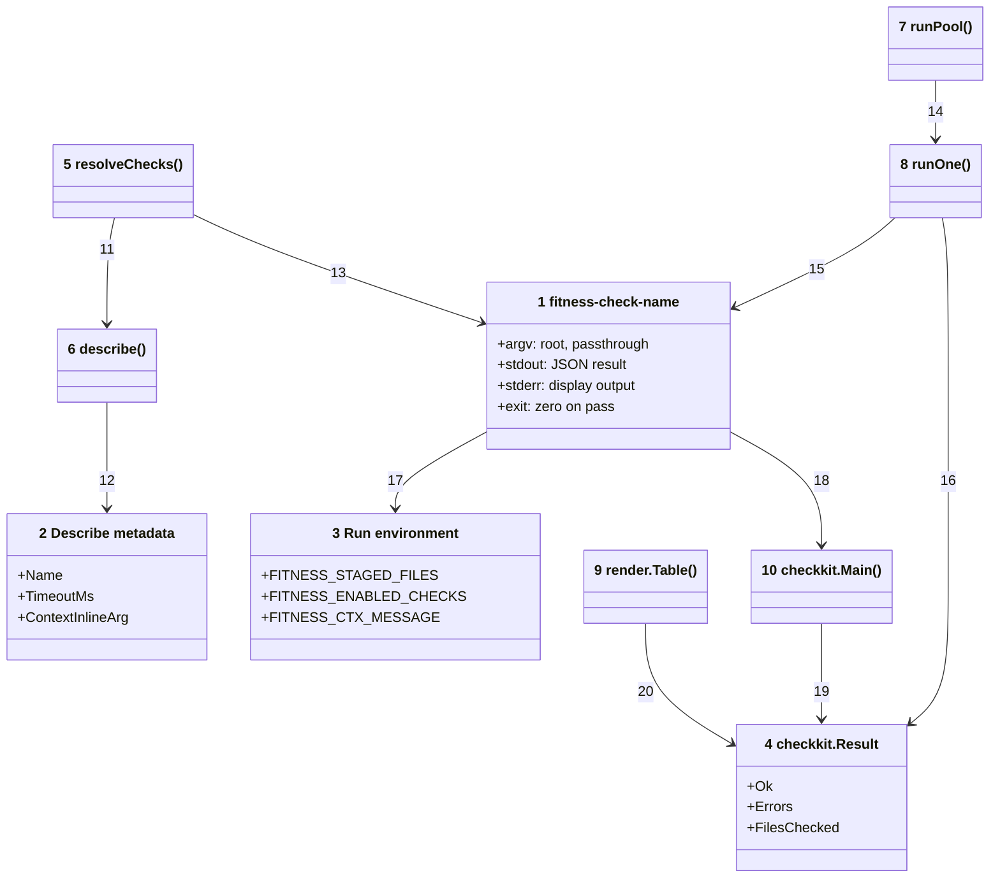
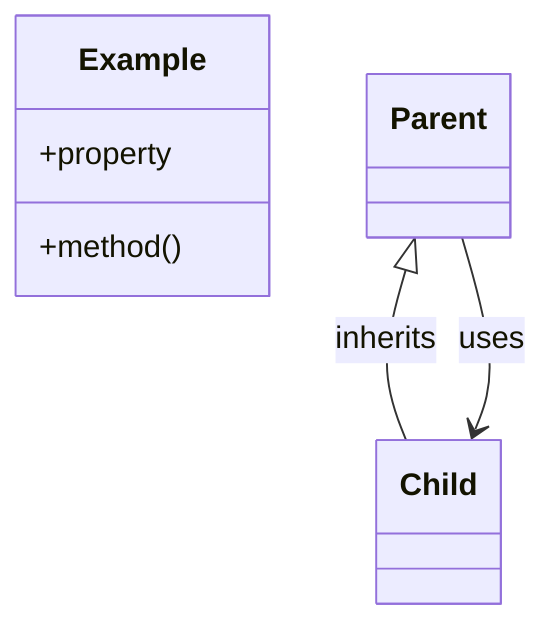

# Code





Numbers on classes and relationships match the callout table.

| #   | Description                                                                                | Why                                                                 | Contract |
| --- | ------------------------------------------------------------------------------------------ | ------------------------------------------------------------------- | --- |
| 1   | The check contract: `fitness-check-name --root dir [args…]`, JSON result on stdout.        | Every check is one executable.                                      | id=check-binary; type=symbol; parent=kit; path=go/internal/checkkit/checkkit.go; symbol=Check |
| 2   | Metadata a check prints for `--describe`: name, timeout budget, context-inline argument.   | The runner discovers capabilities with a handshake, not a registry. | id=describe-metadata; type=symbol; parent=kit; path=go/internal/checkkit/checkkit.go; symbol=Describe |
| 3   | Environment the runner exports before dispatch.                                            | Checks stay stateless; context flows one way.                       | id=run-env; type=component; parent=checks; path=go/internal/checkkit/checkkit.go |
| 4   | `{Ok, Errors, FilesChecked}` — emitted by the check, parsed by the runner.                 | Aggregated into the results table.                                  | id=result; type=symbol; parent=kit; path=go/internal/checkkit/checkkit.go; symbol=Result |
| 5   | Builds the ordered check list: the CLI name, else every check in `allChecks`.              | Single source for which checks run.                                 | id=resolve-checks; type=symbol; parent=resolve; path=go/cmd/fitness/main.go; symbol=resolveChecks |
| 6   | Runs `binary --describe` with a two-second budget and group kill.                          | A check that ignores the flag cannot hang resolution.               | id=describe; type=symbol; parent=resolve; path=go/cmd/fitness/main.go; symbol=describe |
| 7   | Bounded goroutine pool dispatching in order, collecting outcomes by index.                 | Parallel execution with strictly ordered rendering afterwards.      | id=run-pool; type=symbol; parent=execute; path=go/cmd/fitness/main.go; symbol=runPool |
| 8   | Execs one check with `exec.Command` + Setpgid; timeout sends TERM then KILL to the group.  | A hung check's whole child tree dies (5s default budget).           | id=run-one; type=symbol; parent=execute; path=go/cmd/fitness/main.go; symbol=runOne |
| 9   | Renders rows into the bordered table with the totals line.                                 | Deterministic output regardless of completion order.                | id=render-table; type=symbol; parent=output; path=go/internal/render/render.go; symbol=Table |
| 10  | Main scaffolding every check binary delegates to: flag parsing, describe, result emission. | Checks implement one Run function; the protocol lives once.         | id=checkkit-main; type=symbol; parent=kit; path=go/internal/checkkit/checkkit.go; symbol=Main |
| 11  | Resolution asks each resolved binary to describe itself.                                   | Timeouts and inline args ride the same handshake.                   | id=view-04-resolve-checks-describe; type=relationship; from=resolve-checks; to=describe; kind=uses; mode=allowed; evidence=declared |
| 12  | Describe output parsed as JSON.                                                            | Stdlib all the way down.                                            | id=view-04-describe-describe-metadata; type=relationship; from=describe; to=describe-metadata; kind=uses; mode=allowed; evidence=declared |
| 13  | Each name resolves to `fitness-check-<name>` beside the runner, then on PATH.              | Filesystem convention replaces module resolution.                   | id=view-04-resolve-checks-check-binary; type=relationship; from=resolve-checks; to=check-binary; kind=uses; mode=allowed; evidence=declared |
| 14  | The pool runs each outcome slot concurrently under a semaphore.                            | CPU-bounded parallelism.                                            | id=view-04-run-pool-run-one; type=relationship; from=run-pool; to=run-one; kind=uses; mode=allowed; evidence=declared |
| 15  | The wrapper invokes the binary with cwd = root and the context env.                        | Check encapsulates its own tool calls.                              | id=view-04-run-one-check-binary; type=relationship; from=run-one; to=check-binary; kind=uses; mode=allowed; evidence=declared |
| 16  | The last non-empty stdout line parses as the Result; crashes synthesize a failure.         | Stray tool noise ahead of the JSON is tolerated.                    | id=view-04-run-one-result; type=relationship; from=run-one; to=result; kind=uses; mode=allowed; evidence=declared |
| 17  | Binaries read context from the environment via checkkit accessors.                         | No IPC; plain env vars work everywhere.                             | id=view-04-check-binary-run-env; type=relationship; from=check-binary; to=run-env; kind=uses; mode=allowed; evidence=declared |
| 18  | Every check main delegates to `checkkit.Main`.                                             | One protocol implementation across every check binary.              | id=view-04-check-binary-checkkit-main; type=relationship; from=check-binary; to=checkkit-main; kind=uses; mode=allowed; evidence=declared |
| 19  | Pass/Fail helpers build the Result the scaffolding emits.                                  | Uniform shapes, always non-nil error arrays.                        | id=view-04-checkkit-main-result; type=relationship; from=checkkit-main; to=result; kind=uses; mode=allowed; evidence=declared |
| 20  | The renderer reads collected results in dispatch order.                                    | Single summary per invocation.                                      | id=view-04-render-table-result; type=relationship; from=render-table; to=result; kind=uses; mode=allowed; evidence=declared |

## Monorepo layout

```text
fitness-runner/
  .fitnessrc.json              the dogfood exceptions + options
  .github/                     CI and the tag-triggered release workflow
  docs/                        C4 architecture (this folder), plans, research
  go/
    go.mod                     single module, stdlib-only
    cmd/fitness/               runner binary
    cmd/fitness-stamp-changelog/   pre-commit changelog stamper
    cmd/fitness-check-name/    one main + README per check
    internal/                  checkkit, par, walkfs, gitx, mdx, mermaid, spell,
                               clonedetect, vitestconf, mdfilename, render,
                               conf, sharedconf (embedded tool configs)
    bin/                       build output (gitignored)

consumer-repo/                 (not in this monorepo)
  .fitnessrc.json              optional: per-check options
```

## Development in this repo

`mkdir -p bin && go build -o bin ./cmd/...` from `go/` is the whole toolchain (about 300ms warm). `go/bin/fitness` runs the suite this repo gates its own commits on, driven by `.fitnessrc.json`. The pre-commit hook builds, restamps a staged CHANGELOG entry via `fitness-stamp-changelog`, and runs the suite. `go test ./...` covers everything — there are no node scripts left.
