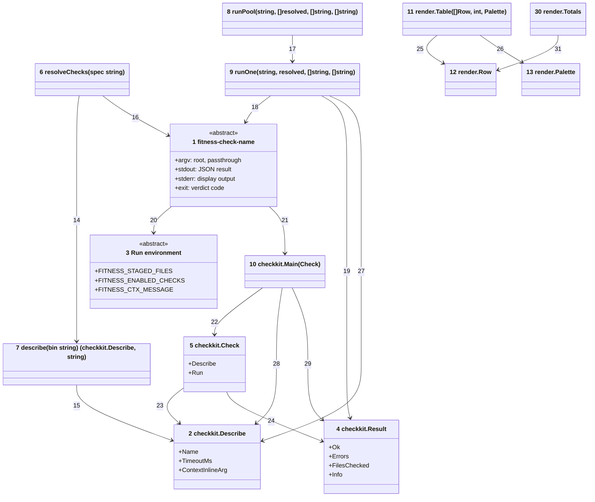
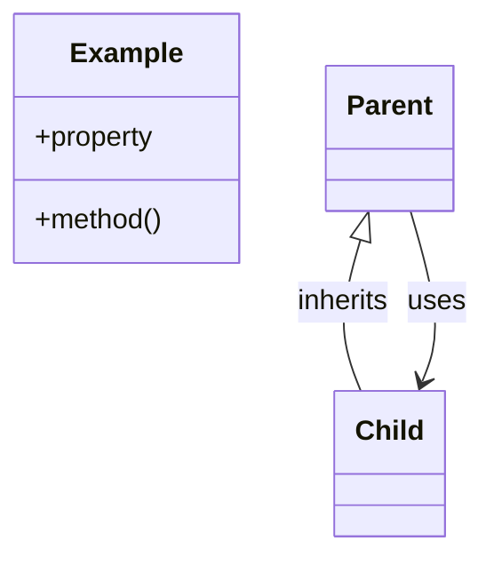

# Code





Numbers on classes and relationships match the callout table.

| #   | Description | Why |
| --- | ----------- | --- |
| 1   | The check contract: `fitness-check-name --root dir [args…]`, JSON result on stdout. | Every check is one executable. |
| 2   | Metadata a check prints for `--describe`, in [checkkit.go](../../go/internal/checkkit/checkkit.go): name, timeout budget, context-inline argument. | The runner discovers capabilities with a handshake, not a registry. |
| 3   | Environment the runner exports before dispatch. | Checks stay stateless; context flows one way. |
| 4   | `{Ok, Errors, FilesChecked, Info}`, in [checkkit.go](../../go/internal/checkkit/checkkit.go): emitted by the check, parsed by the runner. | Aggregated into the results table. |
| 5   | One check in [checkkit.go](../../go/internal/checkkit/checkkit.go): its metadata and its run function. | A check binary is one value handed to the scaffolding. |
| 6   | Builds the ordered check list in [main.go](../../go/cmd/fitness/main.go): the CLI name, else every check in `allChecks`. | Single source for which checks run. |
| 7   | Runs `binary --describe` with a two-second budget and group kill, in [main.go](../../go/cmd/fitness/main.go). A failure becomes an info note. | A check that ignores the flag cannot hang resolution. |
| 8   | Bounded goroutine pool in [main.go](../../go/cmd/fitness/main.go), dispatching in order and collecting outcomes by index. | Parallel execution with strictly ordered rendering afterwards. |
| 9   | Execs one check with `exec.Command` + Setpgid, in [main.go](../../go/cmd/fitness/main.go); timeout sends TERM then KILL to the group. | A hung check's whole child tree dies (5s default budget). |
| 10  | Main scaffolding in [checkkit.go](../../go/internal/checkkit/checkkit.go): flag parsing, describe, result emission. | Checks implement one Run function; the protocol lives once. |
| 11  | Renders rows into the bordered table with the totals line, in [render.go](../../go/internal/render/render.go). | Deterministic output regardless of completion order. |
| 12  | One rendered result, in [render.go](../../go/internal/render/render.go). | The runner turns each outcome into one row. |
| 13  | The escape codes, in [render.go](../../go/internal/render/render.go); the zero value prints no color. | Piped output stays plain. |
| 14  | Resolution asks each resolved binary to describe itself. | Timeouts and inline args ride the same handshake. |
| 15  | Describe output parsed as JSON. | Stdlib all the way down. |
| 16  | Each name resolves to `fitness-check-<name>` beside the runner, then on PATH. | Filesystem convention replaces module resolution. |
| 17  | The pool runs each outcome slot concurrently under a semaphore. | CPU-bounded parallelism. |
| 18  | The wrapper invokes the binary with cwd = root and the context env. | Check encapsulates its own tool calls. |
| 19  | The last non-empty stdout line parses as the Result; a crash, timeout or exit other than 0 or 1 becomes info. | Stray tool noise ahead of the JSON is tolerated. |
| 20  | Binaries read context from the environment via checkkit accessors. | No IPC; plain env vars work everywhere. |
| 21  | Every check main delegates to `checkkit.Main`. | One protocol implementation across every check binary. |
| 22  | The scaffolding runs the check it is given. | One entry point per binary. |
| 23  | A check carries its describe metadata. | The handshake answer lives beside the run function. |
| 24  | The run function returns the Result the scaffolding emits. | Uniform shapes, always non-nil error arrays. |
| 25  | The renderer reads collected rows in dispatch order. | Single summary per invocation. |
| 26  | The renderer colors through the palette it is given. | Color decisions stay with the caller. |
| 27  | The wrapper reads the timeout budget from the check's metadata. | The budget rides the describe handshake. |
| 28  | The scaffolding answers `--describe` with the check's metadata. | Resolution needs no registry. |
| 29  | The scaffolding emits the Result the run returns, or info for a panic or error. | One JSON line per run. |
| 30  | The pass, failure and info counts, in [render.go](../../go/internal/render/render.go). | Info rows never count as failures. |
| 31  | The tally adds each row by its status. | One place decides what counts. |

## Monorepo layout

```text
fitness-runner/
  .fitnessrc.json              the dogfood exceptions + options
  .github/                     CI and the tag-triggered release workflow
  docs/                        C4 architecture (this folder), plans, research
  go/
    go.mod                     single module, stdlib-only
    cmd/fitness/               runner binary
    cmd/fitness-check-name/    one main + README per check
    internal/                  checkkit, par, walkfs, gitx, mdx, mermaid, spell,
                               clonedetect, vitestconf, javascript, nodejs, mdfilename,
                               render, conf, sharedconf (embedded tool configs)
    bin/                       build output (gitignored)

consumer-repo/                 (not in this monorepo)
  .fitnessrc.json              optional: per-check options
```

## Development in this repo

`mkdir -p bin && go build -o bin ./cmd/...` from `go/` is the whole toolchain (about 300ms warm). `go/bin/fitness` runs the suite this repo gates its own commits on, driven by `.fitnessrc.json`. The pre-commit hook builds and runs the suite. `go test ./...` covers everything — there are no node scripts left.
