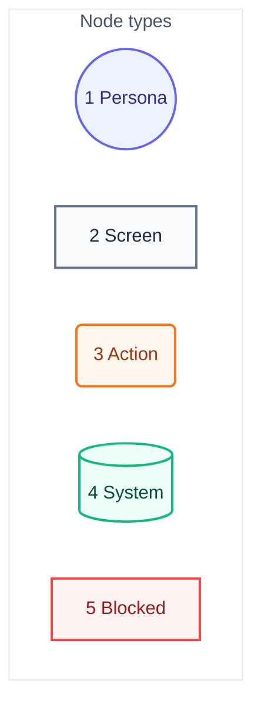
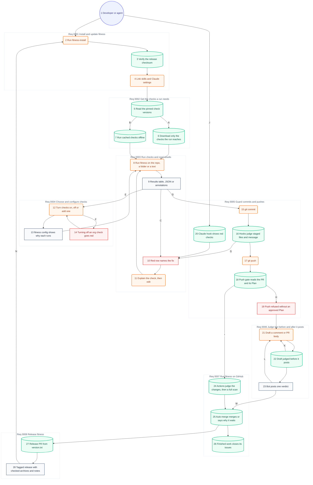

# User Journey

## Legend

Numbers match the callout table. "Screen" is what the person reads: terminal output or a GitHub page.

| #   | Description | Why                                                        |
| --- | ----------- | ---------------------------------------------------------- |
| 1   | Persona     | Developer or AI agent — same CLI, same exit-code contract. |
| 2   | Screen      | What the person reads in the terminal or on GitHub.        |
| 3   | Action      | A command, edit or post the person makes.                  |
| 4   | System      | A step fitness, a hook or a workflow takes for them.       |
| 5   | Blocked     | A red result that stops the person until they fix it.      |

## Journey

Each subgroup is one requirement doc, titled with its ID, in order from top to bottom. The `architecture-journey` check reads those titles, so every step inside names its requirement.

Numbers match the callout table. System context: [01-system-context.md](01-system-context.md). Components: [03-components.md](03-components.md#resolve-check-specs-priority). Code: [04-code.md](04-code.md).

| #   | Description                                     | Type      | Why                                                                     |
| --- | ----------------------------------------------- | --------- | ----------------------------------------------------------------------- |
| 1   | Developer or AI agent.                          | Persona   | Same CLI for a person and an agent; no agent-only path.                 |
| 2   | `fitness-install`, locally or in a GitHub job.  | Action    | One installer gives the release asked for, or the latest.               |
| 3   | The installer checks the release's checksum.    | System    | An unverified release never runs; the installer says why and exits 1.   |
| 4   | `--link-skills` and `--claude-settings`.        | Action    | The agent gets every skill and each hook once, and its own stay.        |
| 5   | The repo's `checkVersions` pins.                | System    | Each run uses the checks the repo pinned, not whatever is newest.       |
| 6   | Lazy, verified check downloads.                 | System    | A run on a few files fetches only the checks those files reach.         |
| 7   | Cached checks when there is no network.         | System    | Work goes on offline; each uncached check says it is offline.           |
| 8   | `fitness`, `fitness <folder>` or `--blob`.      | Action    | The most common entry point, scoped to what the person touched.         |
| 9   | Green, red or info per check, with skips named. | Screen    | The exit code says whether the bar holds; JSON serves agents.           |
| 10  | A failing check's findings.                     | Blocked   | Each finding names the file, the line and the fix.                      |
| 11  | `fitness explain <check>`, then an edit.        | Action    | The binary explains why the check exists before the person reruns.      |
| 12  | A setting or a repo-local check.                | Action    | A repo picks its checks and adds its own.                               |
| 13  | `fitness config`.                               | Screen    | Shows each setting's source and why each check runs or skips.           |
| 14  | A setting that drops an org check.              | Blocked   | The org bar stays whole; the run names the org rule.                    |
| 15  | `git commit`.                                   | Action    | The hooks the repo ships run on every commit.                           |
| 16  | Pre-commit and commit-msg hooks.                | System    | A change or message that breaks a check never becomes a commit.         |
| 17  | `git push`.                                     | Action    | The pre-push hook checks each pushed branch's PR once.                  |
| 18  | The push gate.                                  | System    | PR and Plan findings show before Actions spends a run.                  |
| 19  | A push whose PR closes no approved Plan.        | Blocked   | Work traces to a Plan the owner approved.                               |
| 20  | `fitness claude-hook`.                          | System    | Claude meets red checks as it edits, stops or starts, and fixes them.   |
| 21  | A comment, PR body or issue body.               | Action    | Text is held to rules like code.                                        |
| 22  | `comment-check --blob` or the Claude post hook. | System    | A red draft is denied before it reaches GitHub.                         |
| 23  | comment-check, plan-check, issue-check, pr-check. | Screen  | Each post shows one current verdict that says what to fix.              |
| 24  | The shared workflows on the right runner.       | System    | Changed files are judged first, then everything else.                   |
| 25  | Auto-merge and Release approve.                 | System    | A ready PR or stack merges with no hand click.                          |
| 26  | Parent and child issues close together.         | System    | An issue stays open while work remains, and closes when it is done.     |
| 27  | Release Please and the release tool.            | System    | The version comes from `version.txt`, verified.                         |
| 28  | Archives with hashes, notes and moved major tags. | Screen  | Users install a release whose files and notes match the repo.           |
| A   | Online: the pins are not cached yet.            | Connector | Downloads stay small.                                                   |
| B   | Offline.                                        | Connector | The cache stands in for GitHub.                                         |
| C   | A check is red.                                 | Connector | The person sees what broke.                                             |
| D   | Every check is green.                           | Connector | Green work moves on to a commit.                                        |
| E   | A check does not fit the repo.                  | Connector | The repo tunes its checks instead of ignoring red.                      |
| F   | The setting turns off an org check.             | Connector | Org policy wins over a repo setting.                                    |
| G   | The hooks refuse the commit.                    | Connector | The refusal shows the same red rows as a run.                           |
| H   | No approved Plan.                               | Connector | The fix is a PR body that closes an approved Plan.                      |
| I   | The push goes through.                          | Connector | GitHub takes over the judging.                                          |
| J   | Claude edits, stops or starts a session.        | Connector | The hook judges Claude's work in the same turn.                         |
| K   | The draft is red.                               | Connector | The person edits before anyone reads it.                                |
| L   | The verdict asks for a fix.                     | Connector | The verdict updates once the text is fixed.                             |
| M   | Every verdict passes.                           | Connector | A ready PR goes to merge.                                               |
| N   | The next install fetches the new release.       | Connector | The loop closes: a release reaches every repo.                          |
