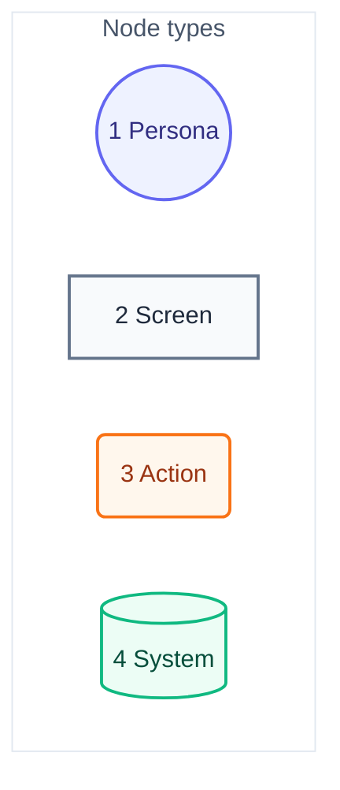
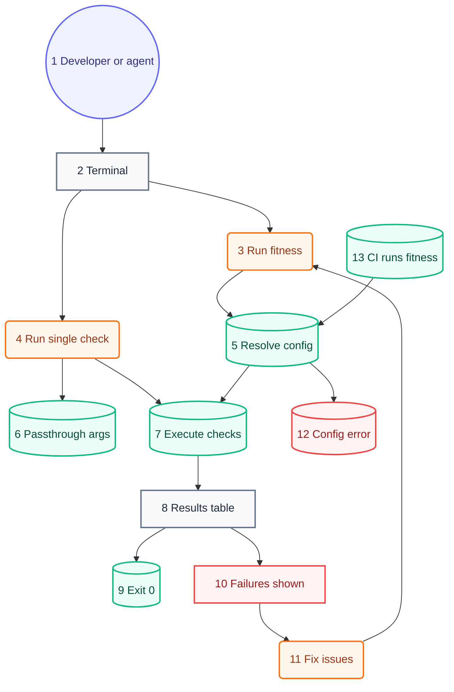

# User Journey

## Legend

Numbers match the callout table. "Screen" is a terminal output state, not a GUI view — this is a CLI.

| #   | Description | Why                                                        |
| --- | ----------- | ---------------------------------------------------------- |
| 1   | Persona     | Developer or AI agent — same CLI, same exit-code contract. |
| 2   | Screen      | What the invoker sees printed to the terminal.             |
| 3   | Action      | A command, flag, or file edit the invoker performs.        |
| 4   | System      | Runner-internal step: resolve, load, execute, exit.        |

## Developer/agent journey

Numbers match the callout table. System context: [01-system-context.md](01-system-context.md). Components: [03-components.md](03-components.md#resolve-check-specs-priority). Code: [04-code.md](04-code.md).

| #   | Description                      | Type    | Why                                                                                                                  |
| --- | -------------------------------- | ------- | -------------------------------------------------------------------------------------------------------------------- |
| 1   | Developer or AI agent.           | Persona | Agent invokes via hook or script; same CLI as a human — no separate agent-only path.                                 |
| 2   | Terminal / shell.                | Screen  | Repo root; the working directory is the app under test, not the runner's own source.                                 |
| 3   | `fitness` (or the pre-commit hook). | Action  | Full-suite run — every session's most common entry point.                                                            |
| 4   | `fitness <name>`.               | Action  | Single-check mode bypasses list resolution entirely.                                                                 |
| 5   | Resolve check list.              | System  | Every built-in check; checks that do not apply pass clean.                                                           |
| 6   | Passthrough args forwarded.      | System  | Args after the check spec reach the check unchanged (e.g. `prettier --write .`).                                     |
| 7   | Run loop executes each check.    | System  | Parallel goroutine pool; every check is a subprocess with its own group-kill timeout.                                |
| 8   | Results table printed.           | Screen  | Pass/fail per check, totals, ANSI formatting.                                                                        |
| 9   | Exit 0.                          | System  | All checks passed — deterministic, not LLM-judged.                                                                   |
| 10  | Failures shown in table.         | Screen  | Exit 1; failing check's `errors` printed inline.                                                                     |
| 11  | Fix and rerun.                   | Action  | Developer/agent edits source, returns to #3.                                                                         |
| 12  | Bad config or missing binary.    | System  | Fails loud — every check ships together, so a missing binary is a broken install.                                    |
| 13  | CI runs the same command.        | System  | Same `fitness` invocation gates the merge — no CI-only config branch.                                                |

## Requirements

Each requirement has a row that lists the journey nodes fulfilling it, by Mermaid ID. The `architecture-journey` check keeps both sides covered.

| Requirement                                                           | Journey                                                      |
| --------------------------------------------------------------------- | ------------------------------------------------------------ |
| [0001](../requirements/0001-engine-runs-checks-reporting-status.md)   | `runFull`, `runSingle`, `executeChecks`, `resultsTable`, `exitZero` |
| [0003](../requirements/0003-checks-self-identify-availability.md)     | `resolveConfig`                                              |
| [0004](../requirements/0004-engine-failures-show-where-i-work.md)     | `failuresShown`, `fixIssues`                                 |
| [0005](../requirements/0005-checks-requirements-go.md)                | `executeChecks`                                              |
| [0006](../requirements/0006-checks-templates.md)                      | `executeChecks`                                              |
| [0007](../requirements/0007-checks-prose-budget.md)                   | `executeChecks`                                              |
| [0008](../requirements/0008-engine-runner-says-what-went-wrong.md)    | `configError`                                                |
| [0009](../requirements/0009-hooks-git-hooks.md)                       | `runFull`                                                    |
| [0010](../requirements/0010-hooks-push-plan.md)                       | `runFull`                                                    |
| [0011](../requirements/0011-hooks-issue-link-once.md)                 | `runFull`                                                    |
| [0012](../requirements/0012-checks-issue-checklist.md)                | `ciRun`                                                      |
| [0013](../requirements/0013-github-plan-issues.md)                    | `ciRun`                                                      |
| [0014](../requirements/0014-github-pull-requests.md)                  | `ciRun`                                                      |
| [0015](../requirements/0015-github-closed-issues.md)                  | `ciRun`                                                      |
| [0016](../requirements/0016-checks-build-output-untracked.md)         | `executeChecks`                                              |
| [0017](../requirements/0017-checks-changelog.md)                      | `executeChecks`                                              |
| [0018](../requirements/0018-checks-changelog-bullets.md)              | `executeChecks`                                              |
| [0019](../requirements/0019-checks-changelog-updated.md)              | `executeChecks`                                              |
| [0020](../requirements/0020-checks-commit-attribution.md)             | `executeChecks`                                              |
| [0021](../requirements/0021-checks-cspell.md)                         | `executeChecks`                                              |
| [0022](../requirements/0022-checks-dependency-currency.md)            | `executeChecks`                                              |
| [0023](../requirements/0023-checks-doc-template.md)                   | `executeChecks`                                              |
| [0024](../requirements/0024-checks-eslint.md)                         | `executeChecks`                                              |
| [0025](../requirements/0025-checks-gitignore-why.md)                  | `executeChecks`                                              |
| [0026](../requirements/0026-checks-go-complexity.md)                  | `executeChecks`                                              |
| [0027](../requirements/0027-checks-go-test.md)                        | `executeChecks`                                              |
| [0028](../requirements/0028-checks-go-test-coverage.md)               | `executeChecks`                                              |
| [0029](../requirements/0029-checks-go-vet.md)                         | `executeChecks`                                              |
| [0030](../requirements/0030-checks-gofmt.md)                          | `executeChecks`                                              |
| [0031](../requirements/0031-checks-issue-link-once.md)                | `executeChecks`                                              |
| [0032](../requirements/0032-checks-jscpd.md)                          | `executeChecks`                                              |
| [0033](../requirements/0033-checks-markdown-filename-camel-case.md)   | `executeChecks`                                              |
| [0034](../requirements/0034-checks-markdown-filename-kebab-case.md)   | `executeChecks`                                              |
| [0035](../requirements/0035-checks-markdown-front-matter.md)          | `executeChecks`                                              |
| [0036](../requirements/0036-checks-markdown-links.md)                 | `executeChecks`                                              |
| [0037](../requirements/0037-checks-markdown-no-bold-italic.md)        | `executeChecks`                                              |
| [0038](../requirements/0038-checks-mermaid-callout-why.md)            | `executeChecks`                                              |
| [0039](../requirements/0039-checks-mermaid-callouts.md)               | `executeChecks`                                              |
| [0040](../requirements/0040-checks-mermaid-diagram-prose.md)          | `executeChecks`                                              |
| [0041](../requirements/0041-checks-mermaid-diagram-table-gap.md)      | `executeChecks`                                              |
| [0042](../requirements/0042-checks-mermaid-legend.md)                 | `executeChecks`                                              |
| [0043](../requirements/0043-checks-mermaid-level-bleed.md)            | `executeChecks`                                              |
| [0044](../requirements/0044-checks-no-contrastive-reframing.md)       | `executeChecks`                                              |
| [0045](../requirements/0045-checks-no-eslint-disable.md)              | `executeChecks`                                              |
| [0046](../requirements/0046-checks-no-plans-dir.md)                   | `executeChecks`                                              |
| [0047](../requirements/0047-checks-node-version.md)                   | `executeChecks`                                              |
| [0048](../requirements/0048-checks-plan-structure.md)                 | `ciRun`                                                      |
| [0049](../requirements/0049-checks-plan-trailer.md)                   | `executeChecks`                                              |
| [0050](../requirements/0050-checks-pr-closes-issue.md)                | `ciRun`                                                      |
| [0051](../requirements/0051-checks-pr-structure.md)                   | `ciRun`                                                      |
| [0052](../requirements/0052-checks-prettier.md)                       | `passArgs`, `executeChecks`                                  |
| [0053](../requirements/0053-checks-read-repo-first.md)                | `executeChecks`                                              |
| [0054](../requirements/0054-checks-release-changelog.md)              | `executeChecks`                                              |
| [0055](../requirements/0055-checks-repeated-string-literals.md)       | `executeChecks`                                              |
| [0056](../requirements/0056-checks-semantic-commit.md)                | `executeChecks`                                              |
| [0057](../requirements/0057-checks-swiftlint.md)                      | `executeChecks`                                              |
| [0058](../requirements/0058-checks-text-readability.md)               | `executeChecks`                                              |
| [0059](../requirements/0059-checks-vitest-coverage-exclude.md)        | `executeChecks`                                              |
| [0060](../requirements/0060-checks-vitest-coverage-full.md)           | `executeChecks`                                              |
| [0061](../requirements/0061-engine-installer.md)                      | `terminal`                                                   |
| [0062](../requirements/0062-engine-release-tool.md)                   | `ciRun`                                                      |
| [0063](../requirements/0063-engine-changelog-stamp.md)                | `runFull`                                                    |
| [0064](../requirements/0064-checks-release-notes.md)                  | `ciRun`                                                      |
| [0065](../requirements/0065-checks-requirements-swift.md)             | `executeChecks`                                              |
| [0066](../requirements/0066-engine-branch-metadata.md)                | `runFull`                                                    |
| [0067](../requirements/0067-checks-local-branch-contexts.md)          | `runFull`                                                    |
| [0068](../requirements/0068-checks-pushed-branches.md)                | `runFull`                                                    |
| [0069](../requirements/0069-github-changelog-entry.md)                | `ciRun`                                                      |
| [0070](../requirements/0070-checks-architecture-contract.md)          | `executeChecks`                                              |
| [0071](../requirements/0071-checks-architecture-journey.md)           | `executeChecks`                                              |
| [0072](../requirements/0072-checks-architecture-containers.md)        | `executeChecks`                                              |
| [0073](../requirements/0073-checks-architecture-actors.md)            | `executeChecks`                                              |
| [0074](../requirements/0074-checks-architecture-components.md)        | `executeChecks`                                              |
