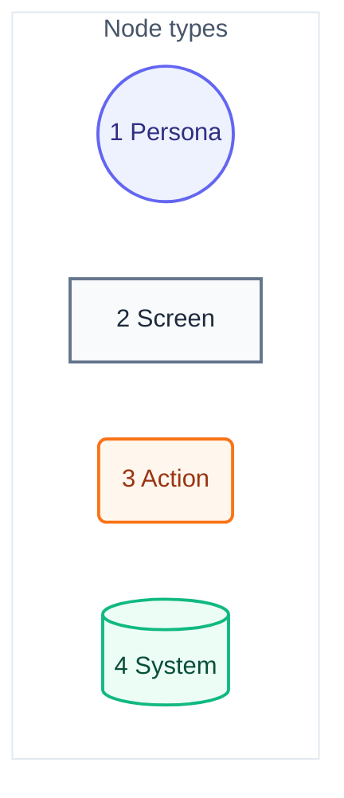
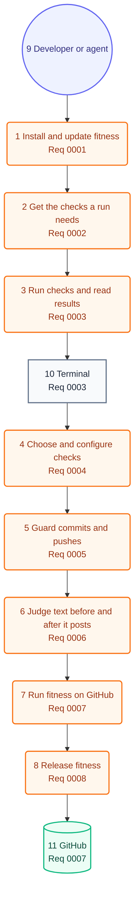

# User Journey

## Legend

Numbers match the callout table. "Screen" is a terminal output state, not a GUI view — this is a CLI.

| #   | Description | Why                                                        |
| --- | ----------- | ---------------------------------------------------------- |
| 1   | Persona     | Developer or AI agent — same CLI, same exit-code contract. |
| 2   | Screen      | What the invoker sees printed to the terminal.             |
| 3   | Action      | A command, flag, or file edit the invoker performs.        |
| 4   | System      | Runner-internal step: resolve, load, execute, exit.        |

## Journey

Each step's label ends with the requirement doc it fulfils, by ID. The `architecture-journey` check requires every doc in some label and an ID on every step.

Numbers match the callout table. System context: [01-system-context.md](01-system-context.md). Components: [03-components.md](03-components.md#resolve-check-specs-priority). Code: [04-code.md](04-code.md).

| #   | Description                           | Type    | Why                                                                      |
| --- | ------------------------------------- | ------- | ------------------------------------------------------------------------ |
| 1   | Install and update fitness.           | Action  | One verified installer gives fitness and its skills, and moves old files. |
| 2   | Get the checks a run needs.           | Action  | Each run gets the pinned checks, verified, and works offline.            |
| 3   | Run checks and read results.          | Action  | Run every check, one, or a folder, and see what broke and how to fix it. |
| 4   | Choose and configure checks.          | Action  | A repo picks its checks and adds its own while the org bar stays whole.  |
| 5   | Guard commits and pushes.             | Action  | Hooks stop work that breaks the bar, and Claude fixes it that turn.      |
| 6   | Judge text before and after it posts. | Action  | A bad comment or body is caught before it posts, with one verdict after. |
| 7   | Run fitness on GitHub.                | Action  | Actions run fitness on every change and merge ready pull requests.       |
| 8   | Release fitness.                      | Action  | A release builds checked archives and notes from `version.txt`.          |
| 9   | Developer or AI agent.                | Persona | Same CLI for a person and an agent; no agent-only path.                  |
| 10  | Terminal.                             | Screen  | Results print where the command ran: table, JSON or Actions output.      |
| 11  | GitHub.                               | System  | Checks, verdicts, merges and releases land on the repo.                  |
