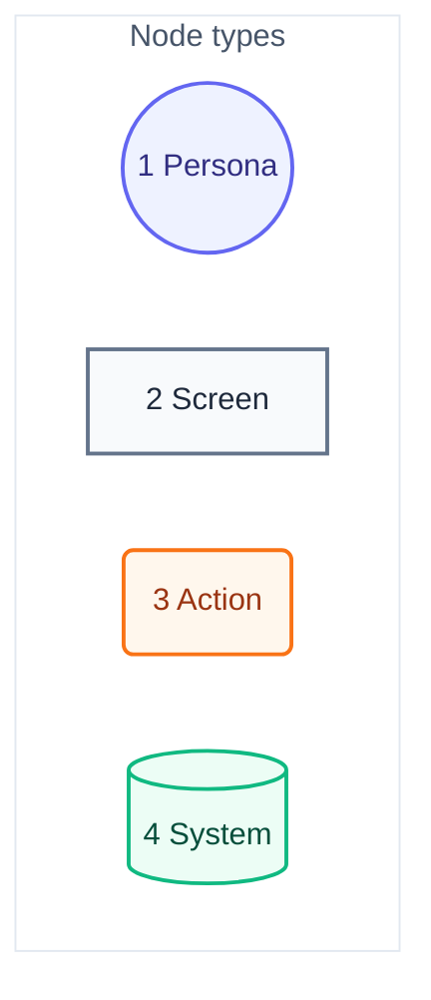
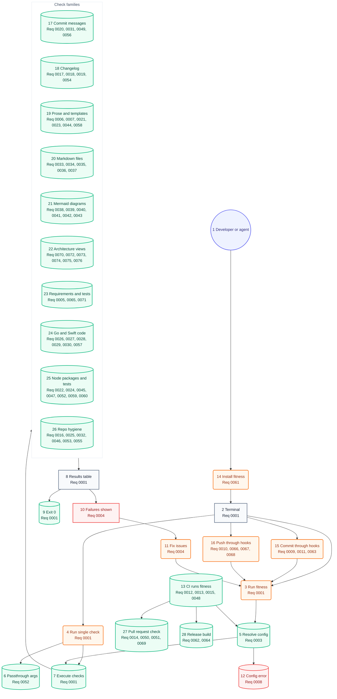

# User Journey

## Legend

Numbers match the callout table. "Screen" is a terminal output state, not a GUI view — this is a CLI.

| #   | Description | Why                                                        |
| --- | ----------- | ---------------------------------------------------------- |
| 1   | Persona     | Developer or AI agent — same CLI, same exit-code contract. |
| 2   | Screen      | What the invoker sees printed to the terminal.             |
| 3   | Action      | A command, flag, or file edit the invoker performs.        |
| 4   | System      | Runner-internal step: resolve, load, execute, exit.        |

## Developer/agent journey

Each step's label ends with the requirement docs it fulfils, by ID. The `architecture-journey` check requires every doc in some label and an ID on every step.

Numbers match the callout table. System context: [01-system-context.md](01-system-context.md). Components: [03-components.md](03-components.md#resolve-check-specs-priority). Code: [04-code.md](04-code.md).

| #   | Description                         | Type    | Why                                                                                   |
| --- | ----------------------------------- | ------- | ------------------------------------------------------------------------------------- |
| 1   | Developer or AI agent.              | Persona | Agent invokes via hook or script; same CLI as a human — no separate agent-only path.  |
| 2   | Terminal / shell.                   | Screen  | Repo root; the working directory is the app under test, not the runner's own source.  |
| 3   | `fitness` (or the pre-commit hook). | Action  | Full-suite run — every session's most common entry point.                             |
| 4   | `fitness <name>`.                   | Action  | Single-check mode bypasses list resolution entirely.                                  |
| 5   | Resolve check list.                 | System  | Every built-in check; checks that do not apply pass clean.                            |
| 6   | Passthrough args forwarded.         | System  | Args after the check spec reach the check unchanged (e.g. `prettier --write .`).      |
| 7   | Run loop executes each check.       | System  | Parallel goroutine pool; every check is a subprocess with its own group-kill timeout. |
| 8   | Results table printed.              | Screen  | Pass/fail per check, totals, ANSI formatting.                                         |
| 9   | Exit 0.                             | System  | All checks passed — deterministic, not LLM-judged.                                    |
| 10  | Failures shown in table.            | Screen  | Exit 1; failing check's `errors` printed inline.                                      |
| 11  | Fix and rerun.                      | Action  | Developer/agent edits source, returns to #3.                                          |
| 12  | Bad config or missing binary.       | System  | Fails loud — every check ships together, so a missing binary is a broken install.     |
| 13  | CI runs the same command.           | System  | Same `fitness` invocation gates the merge, and Plan issues are judged there too.      |
| 14  | Installer puts `fitness` on PATH.   | Action  | One verified download gives every check; nothing else to install.                     |
| 15  | `git commit` runs the hooks.        | Action  | Hooks run the suite, stamp the changelog, and keep each issue linked once.            |
| 16  | `git push` runs the hooks.          | Action  | A push must trace to an approved Plan, with branch metadata checked first.            |
| 17  | Commit message checks.              | System  | Semantic subject, attribution, Plan trailer, and one link per issue.                  |
| 18  | Changelog checks.                   | System  | Each change has one dated entry whose bullets match the change.                       |
| 19  | Prose and template checks.          | System  | Docs stay short, readable, spelled right, and shaped by their templates.              |
| 20  | Markdown file checks.               | System  | File names, front matter, links, and emphasis follow one convention.                  |
| 21  | Mermaid diagram checks.             | System  | Diagrams carry legends, callouts, and tables that explain each number.                |
| 22  | Architecture view checks.           | System  | Views match actors, runtimes, folders, symbols, and this journey.                     |
| 23  | Requirement and test checks.        | System  | Each acceptance has one test, and a doc changes with its test.                        |
| 24  | Go and Swift code checks.           | System  | Format, vet, tests, coverage, complexity, and lint gate the code.                     |
| 25  | Node package and test checks.       | System  | Lint, format, Node version, dependencies, and test coverage stay current.             |
| 26  | Repo hygiene checks.                | System  | No build output, plan files, unexplained ignores, or copied code.                     |
| 27  | Pull request check.                 | System  | A pull request's body, closed issues, and changelog link are judged in CI.            |
| 28  | Release build.                      | System  | The release tool builds bundles and publishes notes that link the changelog.          |
