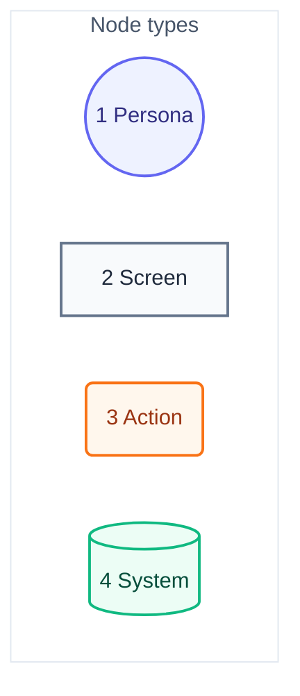
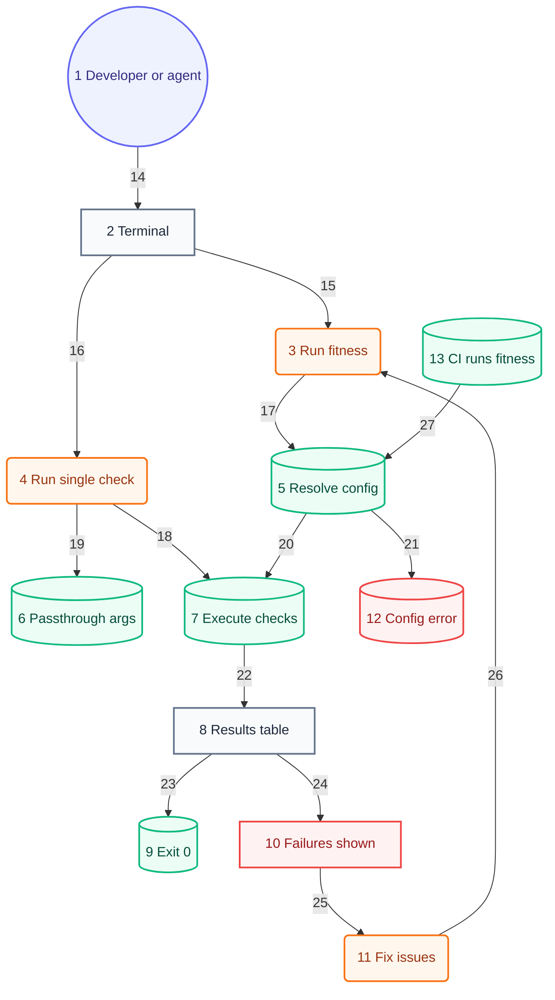

# User Journey

## Legend

Numbers match the callout table. "Screen" is a terminal output state, not a GUI view — this is a CLI.

| #   | Description | Why                                                        |
| --- | ----------- | ---------------------------------------------------------- |
| 1   | Persona     | Developer or AI agent — same CLI, same exit-code contract. |
| 2   | Screen      | What the invoker sees printed to the terminal.             |
| 3   | Action      | A command, flag, or file edit the invoker performs.        |
| 4   | System      | Runner-internal step: resolve, load, execute, exit.        |

## Developer/agent journey

Numbers match the callout table. System context: [01-system-context.md](01-system-context.md). Components: [03-components.md](03-components.md#resolve-check-specs-priority). Code: [04-code.md](04-code.md).

| #   | Description                      | Type    | Why                                                                                                                  | Contract |
| --- | -------------------------------- | ------- | -------------------------------------------------------------------------------------------------------------------- | --- |
| 1   | Developer or AI agent.           | Persona | Agent invokes via hook or script; same CLI as a human — no separate agent-only path.                                 | ref=developer |
| 2   | Terminal / shell.                | Screen  | Repo root; the working directory is the app under test, not the runner's own source.                                 | id=terminal; type=behavior; requirements=0001 |
| 3   | `fitness` (or the pre-commit hook). | Action  | Full-suite run — every session's most common entry point.                                                            | id=run-full; type=behavior; requirements=0001 |
| 4   | `fitness <name>`.               | Action  | Single-check mode bypasses list resolution entirely.                                                                 | id=run-single; type=behavior; requirements=0001 |
| 5   | Resolve check list.              | System  | Every built-in check; checks that do not apply pass clean.                                                           | id=resolve-config; type=behavior; requirements=0008 |
| 6   | Passthrough args forwarded.      | System  | Args after the check spec reach the check unchanged (e.g. `prettier --write .`).                                     | id=pass-args; type=behavior; requirements=0001 |
| 7   | Run loop executes each check.    | System  | Parallel goroutine pool; every check is a subprocess with its own group-kill timeout.                                | id=execute-checks; type=behavior; requirements=0001 |
| 8   | Results table printed.           | Screen  | Pass/fail per check, totals, ANSI formatting.                                                                        | id=results-table; type=behavior; requirements=0001 |
| 9   | Exit 0.                          | System  | All checks passed — deterministic, not LLM-judged.                                                                   | id=exit-zero; type=behavior; requirements=0001 |
| 10  | Failures shown in table.         | Screen  | Exit 1; failing check's `errors` printed inline.                                                                     | id=failures-shown; type=behavior; requirements=0004 |
| 11  | Fix and rerun.                   | Action  | Developer/agent edits source, returns to #3.                                                                         | id=fix-issues; type=behavior; requirements=0004 |
| 12  | Bad config or missing binary.    | System  | Fails loud — every check ships together, so a missing binary is a broken install.                                    | id=config-error; type=behavior; requirements=0008 |
| 13  | CI runs the same command.        | System  | Same `fitness` invocation gates the merge — no CI-only config branch.                                                | id=ci-run; type=behavior; requirements=0004 |
| 14 | developer leads to terminal. | Flow | Shows the next step. | id=view-05-developer-terminal; type=relationship; from=developer; to=terminal; kind=navigates; mode=allowed; evidence=declared |
| 15 | terminal leads to run-full. | Flow | Shows the next step. | id=view-05-terminal-run-full; type=relationship; from=terminal; to=run-full; kind=navigates; mode=allowed; evidence=declared |
| 16 | terminal leads to run-single. | Flow | Shows the next step. | id=view-05-terminal-run-single; type=relationship; from=terminal; to=run-single; kind=navigates; mode=allowed; evidence=declared |
| 17 | run-full leads to resolve-config. | Flow | Shows the next step. | id=view-05-run-full-resolve-config; type=relationship; from=run-full; to=resolve-config; kind=navigates; mode=allowed; evidence=declared |
| 18 | run-single leads to execute-checks. | Flow | Shows the next step. | id=view-05-run-single-execute-checks; type=relationship; from=run-single; to=execute-checks; kind=navigates; mode=allowed; evidence=declared |
| 19 | run-single leads to pass-args. | Flow | Shows the next step. | id=view-05-run-single-pass-args; type=relationship; from=run-single; to=pass-args; kind=navigates; mode=allowed; evidence=declared |
| 20 | resolve-config leads to execute-checks. | Flow | Shows the next step. | id=view-05-resolve-config-execute-checks; type=relationship; from=resolve-config; to=execute-checks; kind=navigates; mode=allowed; evidence=declared |
| 21 | resolve-config leads to config-error. | Flow | Shows the next step. | id=view-05-resolve-config-config-error; type=relationship; from=resolve-config; to=config-error; kind=navigates; mode=allowed; evidence=declared |
| 22 | execute-checks leads to results-table. | Flow | Shows the next step. | id=view-05-execute-checks-results-table; type=relationship; from=execute-checks; to=results-table; kind=navigates; mode=allowed; evidence=declared |
| 23 | results-table leads to exit-zero. | Flow | Shows the next step. | id=view-05-results-table-exit-zero; type=relationship; from=results-table; to=exit-zero; kind=navigates; mode=allowed; evidence=declared |
| 24 | results-table leads to failures-shown. | Flow | Shows the next step. | id=view-05-results-table-failures-shown; type=relationship; from=results-table; to=failures-shown; kind=navigates; mode=allowed; evidence=declared |
| 25 | failures-shown leads to fix-issues. | Flow | Shows the next step. | id=view-05-failures-shown-fix-issues; type=relationship; from=failures-shown; to=fix-issues; kind=navigates; mode=allowed; evidence=declared |
| 26 | fix-issues leads to run-full. | Flow | Shows the next step. | id=view-05-fix-issues-run-full; type=relationship; from=fix-issues; to=run-full; kind=navigates; mode=allowed; evidence=declared |
| 27 | ci-run leads to resolve-config. | Flow | Shows the next step. | id=view-05-ci-run-resolve-config; type=relationship; from=ci-run; to=resolve-config; kind=navigates; mode=allowed; evidence=declared |
