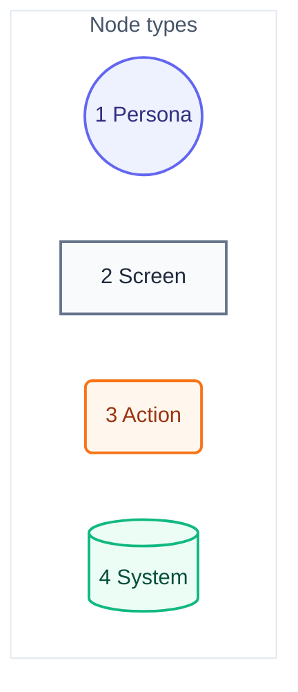

# User Journey

## Legend

Numbers match the callout table. "Screen" is a terminal output state, not a GUI view — this is a CLI.

| #   | Description | Why                                                        |
| --- | ----------- | ---------------------------------------------------------- |
| 1   | Persona     | Developer or AI agent — same CLI, same exit-code contract. |
| 2   | Screen      | What the invoker sees printed to the terminal.             |
| 3   | Action      | A command, flag, or file edit the invoker performs.        |
| 4   | System      | Runner-internal step: resolve, load, execute, exit.        |

## Journey

Each step's label ends with the requirement docs it fulfils, by ID. The `architecture-journey` check requires every doc in some label and an ID on every step.

```mermaid
flowchart TB
    dev((1 Developer or agent)):::persona
    install(14 Install fitness<br/>Req 0061, 0088, 0098, 0099, 0164, 0166, 0168, 0169):::action
    terminal[2 Terminal<br/>Req 0001]:::screen
    runFull(3 Run fitness<br/>Req 0001, 0144):::action
    runSingle(4 Run single check or folder<br/>Req 0001, 0100):::action
    runBlob(29 Check a draft text<br/>Req 0077):::action
    runComment(31 Check a draft comment<br/>Req 0083):::action
    stripFront(33 Strip front matter<br/>Req 0096):::action
    listComments(40 List code comments<br/>Req 0136):::action
    migrateADRs(43 Move ADR files into issues<br/>Req 0149):::action
    claudeHooks(42 Edit, post, stop or start in Claude Code<br/>Req 0142, 0143, 0145, 0155):::action
    listChecks(34 List the checks<br/>Req 0110):::action
    explainCheck(35 Explain a check<br/>Req 0111):::action
    readDocs(36 Read the docs topics<br/>Req 0112):::action
    readReadme(37 Read a check README<br/>Req 0114):::action
    readLLMs(38 Read the llms page<br/>Req 0113):::action
    commitHook(15 Commit through hooks<br/>Req 0009, 0011, 0122):::action
    pushHook(16 Push through hooks<br/>Req 0010, 0066, 0067, 0068):::action
    resolveConfig[(5 Resolve config<br/>Req 0090, 0102, 0131, 0162, 0163)]:::system
    executeChecks[(7 Execute checks<br/>Req 0001, 0140)]:::system

    subgraph checks["Checks"]
        installedChecks[(17 Installed fitness-checks programs<br/>Req 0162, 0163, 0164)]:::system
        branchCheck[(18 local-branch, which the engine judges<br/>Req 0067, 0068)]:::system
        timeoutChecks[(46 Workflow timeouts<br/>Req 0150)]:::system
    end

    resultsTable[8 Results table<br/>Req 0001, 0101]:::screen
    exitZero[(9 Exit 0<br/>Req 0001)]:::system
    failuresShown[10 Failures shown<br/>Req 0004]:::blocked
    fixIssues(11 Fix issues<br/>Req 0004):::action
    configError[(12 Config error<br/>Req 0008)]:::blocked
    ciRun[(13 CI runs fitness<br/>Req 0013, 0015, 0082, 0087, 0120, 0138)]:::system
    prCheck[(27 Pull request check<br/>Req 0014, 0069, 0091, 0095)]:::system
    adrIssues[(45 ADR issues<br/>Req 0148)]:::system
    suiteRunner[(47 Suite runner<br/>Req 0158, 0165)]:::system
    checkDeps[(48 Check dependencies<br/>Req 0161)]:::system
    release[(28 Release build<br/>Req 0062, 0092, 0093, 0094, 0121)]:::system
    perfRecord[(32 Performance record<br/>Req 0089, 0146)]:::system
    closeParents[(39 Close parent issues<br/>Req 0134, 0135, 0167)]:::system

    dev --> install
    install --> terminal
    terminal --> runFull
    terminal --> runSingle
    terminal --> commitHook
    terminal --> pushHook
    terminal --> runBlob
    terminal --> runComment
    terminal --> stripFront
    terminal --> listComments
    terminal --> migrateADRs
    dev --> claudeHooks
    claudeHooks --> executeChecks
    terminal --> listChecks
    listChecks --> explainCheck
    terminal --> readDocs
    explainCheck --> readReadme
    terminal --> readLLMs
    commitHook --> runFull
    pushHook --> runFull
    runFull --> resolveConfig
    runSingle --> executeChecks
    runBlob --> executeChecks
    runComment --> executeChecks
    resolveConfig --> executeChecks
    resolveConfig --> configError
    executeChecks --> checks
    checks --> resultsTable
    resultsTable --> exitZero
    resultsTable --> failuresShown
    failuresShown --> fixIssues
    fixIssues --> runFull
    ciRun --> resolveConfig
    ciRun --> prCheck
    ciRun --> release
    ciRun --> closeParents
    ciRun --> adrIssues
    ciRun --> suiteRunner
    resultsTable --> perfRecord
    release --> perfRecord
    release --> checkDeps

    classDef persona fill:#eef2ff,stroke:#6366f1,color:#312e81,stroke-width:2px
    classDef screen fill:#f8fafc,stroke:#64748b,color:#1e293b,stroke-width:2px
    classDef action fill:#fff7ed,stroke:#f97316,color:#9a3412,stroke-width:2px
    classDef system fill:#ecfdf5,stroke:#10b981,color:#064e3b,stroke-width:2px
    classDef blocked fill:#fef2f2,stroke:#ef4444,color:#991b1b,stroke-width:2px

    style checks fill:#ffffff,stroke:#e2e8f0,color:#475569,stroke-width:1px
```

Numbers match the callout table. System context: [01-system-context.md](01-system-context.md). Components: [03-components.md](03-components.md#resolve-check-specs-priority). Code: [04-code.md](04-code.md).

| #   | Description                         | Type    | Why                                                                                   |
| --- | ----------------------------------- | ------- | ------------------------------------------------------------------------------------- |
| 1   | Developer or AI agent.              | Persona | Agent invokes via hook or script; same CLI as a human — no separate agent-only path.  |
| 2   | Terminal / shell.                   | Screen  | Repo root; the working directory is the app under test, not the runner's own source.  |
| 3   | `fitness` (or the pre-commit hook). | Action  | Full-suite run — every session's most common entry point.                             |
| 4   | `fitness <name>`.                   | Action  | Single-check mode bypasses list resolution entirely.                                  |
| 5   | Resolve check list.                 | System  | Every installed check and `local-branch`, then the repo's local checks; checks that do not apply pass. |
| 7   | Run loop executes each check.       | System  | Parallel goroutine pool; every check is a subprocess with its own group-kill timeout. |
| 8   | Results table printed.              | Screen  | Pass, fail or info per check, totals, ANSI formatting.                                |
| 9   | Exit 0.                             | System  | All checks passed — deterministic, not LLM-judged.                                    |
| 10  | Failures shown in table.            | Screen  | Exit 1; failing check's `errors` printed inline.                                      |
| 11  | Fix and rerun.                      | Action  | Developer/agent edits source, returns to #3.                                          |
| 12  | Bad config or missing binary.       | System  | Fails loud — every check ships together, so a missing binary is a broken install.     |
| 13  | CI runs the same command.           | System  | Same `fitness` invocation gates the merge, after a pull request's changes pass, with a full scan. Labeled issues are judged by kind, and repeats are noted. |
| 14  | Installer puts `fitness` on PATH.   | Action  | One verified download gives every check; nothing else to install.                     |
| 15  | `git commit` runs the hooks.        | Action  | Hooks run the suite and keep each issue linked once.                                  |
| 16  | `git push` runs the hooks.          | Action  | A push must trace to an approved Plan, with branch metadata checked first.            |
| 17  | Installed checks.                   | System  | Each check the repo pins runs as its own fitness-checks program, installed beside the engine. |
| 18  | `local-branch`.                     | System  | The engine judges this branch's PR and Plans itself, with its own GitHub reads.        |
| 27  | Pull request check.                 | System  | A pull request's body, closed issues, and changelog link are judged in CI; Auto-merge waits out stacks. |
| 28  | Release build.                      | System  | The release tool builds bundles and notes; opted-in repos call the shared Release Please. |
| 29  | `fitness --blob <text>`.            | Action  | Blob-capable checks judge a draft text alone; checks that need files are skipped.     |
| 31  | `fitness comment-check --blob -`. | Action | An agent judges a draft comment before posting it; CI replies once to one that fails. |
| 32  | Performance record.                 | System  | Each run and release records check costs and install time; a box diagram draws them. |
| 33  | `fitness strip-front-matter`.       | Action  | A repo drops the fitness keys no check reads; other keys stay.                        |
| 34  | `fitness list`.                     | Action  | An agent learns every check, its scope, and whether this repo runs it, from the binary. |
| 35  | `fitness explain <check>`.          | Action  | An agent reads why a check exists and the keys it reads, generated from its code comments. |
| 36  | `fitness docs [topic]`.             | Action  | An agent reads the protocol, config and GitHub commands from the binary, as the code documents them. |
| 37  | A check README or `fitness --help`. | Action  | A person reads the same documentation the binary prints, generated from the same code. |
| 38  | `fitness llms` or `llms.txt`.       | Action  | An agent reads one page naming every command, exit code, check and topic, generated from code. |
| 39  | Close parent issues.                | System  | A closed child finishes its parent, and the parent's parent, when no other work is left.   |
| 40  | `fitness comments`.                 | Action  | A person sees each code comment a check reads, with its line, language and kind. |
| 42  | `fitness claude-hook`.              | Action  | Claude meets a failing check right after an edit, before a `gh` post, as it or a subagent stops, or as a session starts, and fixes it that turn. |
| 43  | `fitness adr-migrate`.              | Action  | Each ADR file becomes an `ADR` issue people can discuss, and links follow it. |
| 45  | ADR issue check.                    | System  | Each `ADR` issue states its title, Background, Decision and Currently Known Consequences alike. |
| 46  | Workflow timeout check.             | System  | Each long workflow timeout cites the observed maximum that justifies it. |
| 47  | Suite runner.                       | System  | A repo whose checks build Apple apps runs the suite on a standard hosted Mac it names. |
| 48  | Check dependencies.                 | System  | No check depends on the engine's GitHub reactions or run reports, and the engine links checks only through its built-ins map, so each side can build alone. |
