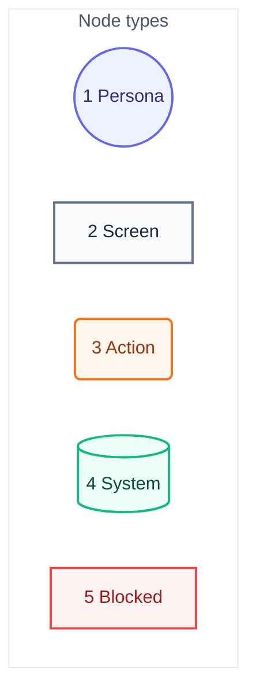
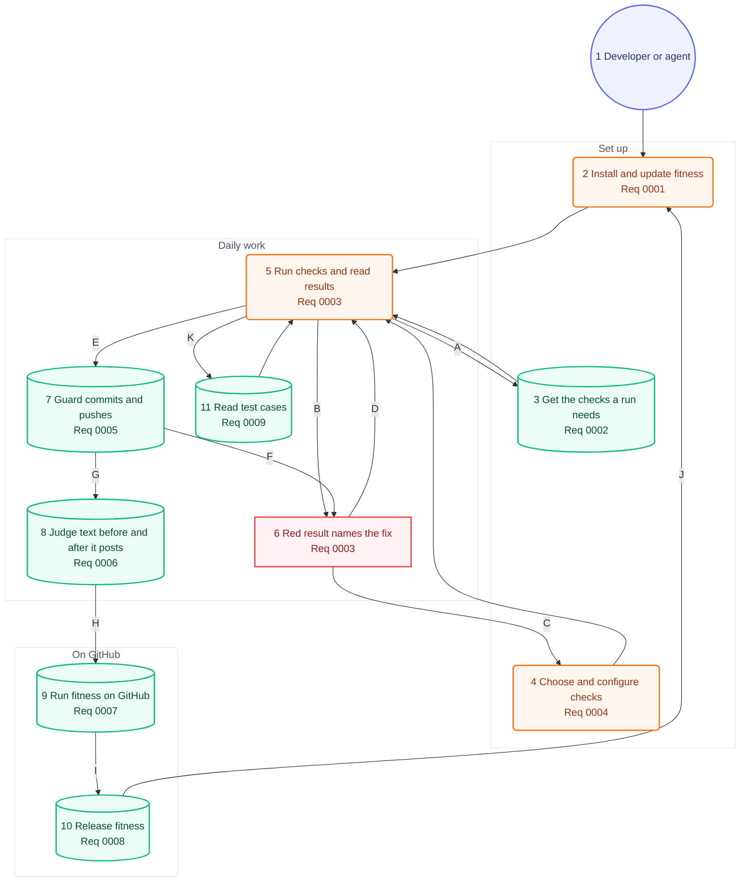

# User Journey

## Legend

Numbers match the callout table. "Screen" is what the person reads: terminal output or a GitHub page.

| #   | Description | Why                                                        |
| --- | ----------- | ---------------------------------------------------------- |
| 1   | Persona     | Developer or AI agent — same CLI, same exit-code contract. |
| 2   | Screen      | What the person reads in the terminal or on GitHub.        |
| 3   | Action      | A command, edit or post the person makes.                  |
| 4   | System      | A step fitness, a hook or a workflow takes for them.       |
| 5   | Blocked     | A red result that stops the person until they fix it.      |

## Journey

Each node is one whole requirement doc, named with its ID; the groups are the phases a user moves through. The `architecture-journey` check reads those IDs.

Numbers match the callout table. System context: [01-system-context.md](01-system-context.md). Components: [03-components.md](03-components.md#resolve-check-specs-priority). Code: [04-code.md](04-code.md).

| #   | Description                                                   | Type      | Why                                                                |
| --- | ------------------------------------------------------------- | --------- | ------------------------------------------------------------------ |
| 1   | Developer or AI agent.                                        | Persona   | Same CLI for a person and an agent; no agent-only path.            |
| 2   | `fitness-install`, its skills and Claude settings.            | Action    | One installer gives the verified release asked for, or the latest. |
| 3   | The repo's pinned checks, downloaded lazily or from cache.    | System    | Each run uses the checks the repo pinned, even offline.            |
| 4   | Settings, repo-local checks and `fitness config`.             | Action    | A repo tunes its checks while the org bar stays whole.             |
| 5   | `fitness` on the repo, a folder or a text.                    | Action    | The most common entry point; the exit code says if the bar holds.  |
| 6   | A failing check's findings.                                   | Blocked   | Each finding names the file, the line and the fix.                 |
| 7   | Git hooks, the push gate and the Claude hook.                 | System    | Red work stops on the machine, before review.                      |
| 8   | Drafts judged before they post, and one verdict on GitHub.    | System    | Text is held to rules like code.                                   |
| 9   | Shared workflows, issue upkeep and Auto-merge.                | System    | Every change is judged, and a ready PR merges with no hand click.  |
| 10  | A tagged release from `version.txt` with checked archives.    | System    | Users install a release whose files and notes match the repo.      |
| 11  | Each case a requirement test runs, shared with the checks.    | System    | A requirement step ties to the case that proves it.                |
| A   | The run needs checks it has not cached.                       | Connector | Only the checks the input reaches download.                        |
| B   | A check is red.                                               | Connector | The person sees what broke.                                        |
| C   | The check does not fit the repo.                              | Connector | The repo tunes its checks instead of ignoring red.                 |
| D   | Fix the code and run again.                                   | Connector | Fix the code, never the check.                                     |
| E   | Every check is green; commit and push.                        | Connector | Green work moves on.                                               |
| F   | A hook refuses the commit or push.                            | Connector | The refusal shows the same red rows as a run.                      |
| G   | The push goes through; the PR body and comments are drafted.  | Connector | Text meets the rules before anyone reads it.                       |
| H   | Every verdict passes.                                         | Connector | GitHub takes over the judging.                                     |
| I   | Merged fitness changes reach a release PR.                    | Connector | Every merge ships in the next release.                             |
| J   | The next install fetches the new release.                     | Connector | The loop closes: a release reaches every repo.                     |
| K   | A check of the repo's own reads the tests.                    | Connector | It judges each step against the case named for it.                 |
