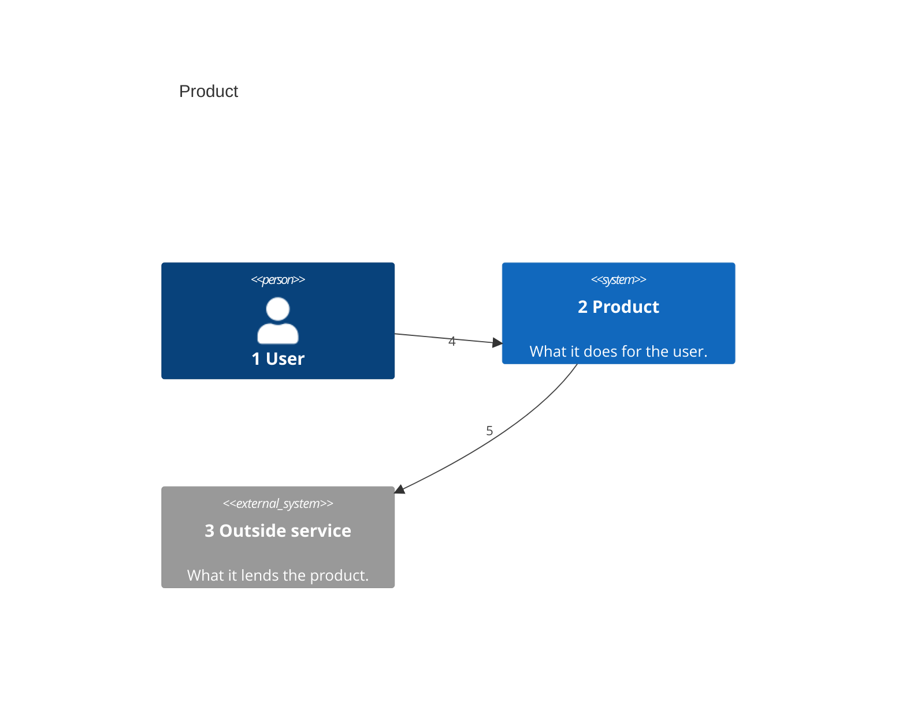
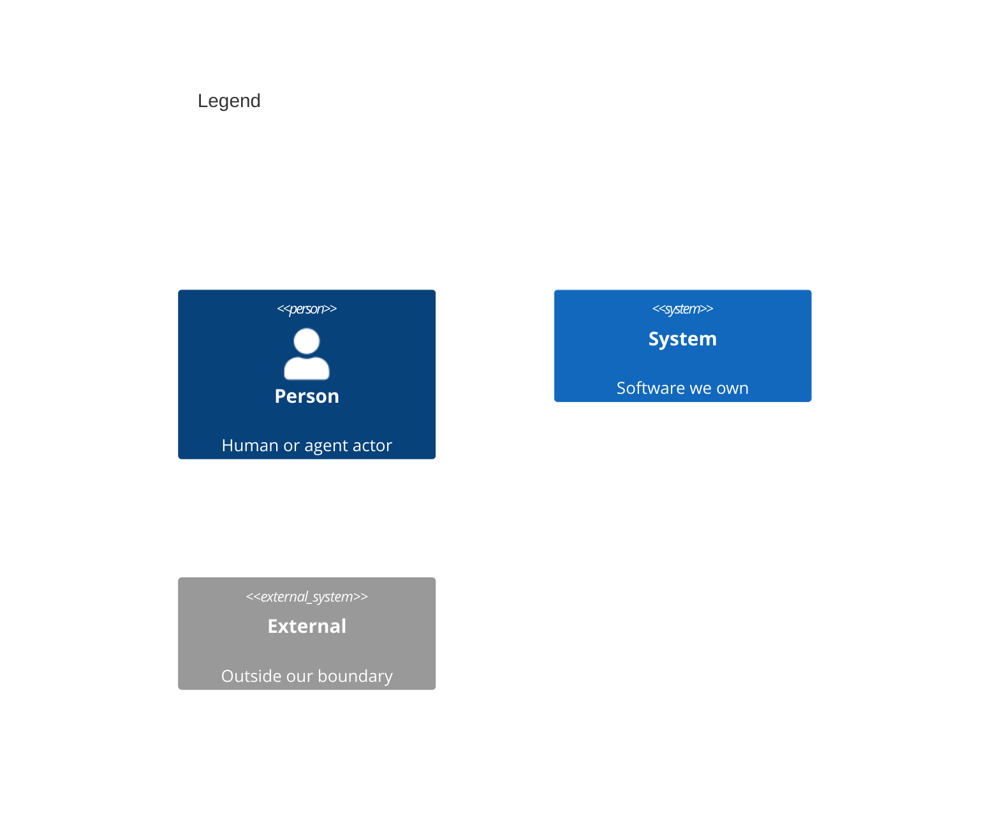

# System Context

<!-- Copy to docs/architecture/01-system-context.md. One C4Context diagram: each person and outside system the product meets. A number opens each label and arrow, and each number has a row in the callout table. -->

<!-- The legend is a second C4Context diagram titled Legend, with one sample of each element kind above. -->

Numbers on nodes and arrows match the callout table.

| #   | Description                         | Why                                       |
| --- | ----------------------------------- | ----------------------------------------- |
| 1   | The person who uses the product.    | Requirements name this actor in a Given.  |
| 2   | The product this repo builds.       | The boundary the other views break down.  |
| 3   | A system the product relies on.     | It sits outside the product's boundary.   |
| 4   | The user works in the product.      | The main way in.                          |
| 5   | The product calls the outside service. | The one dependency it does not own.    |
