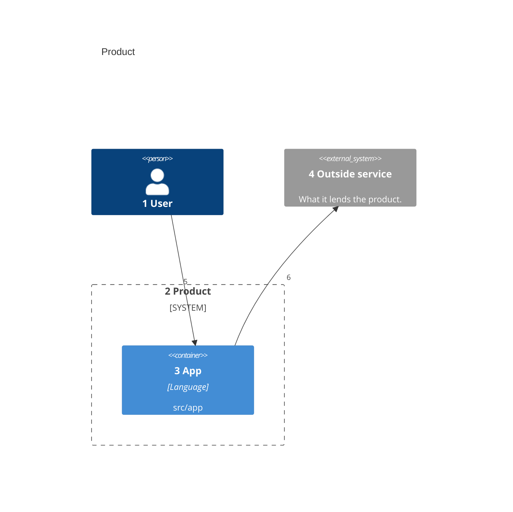
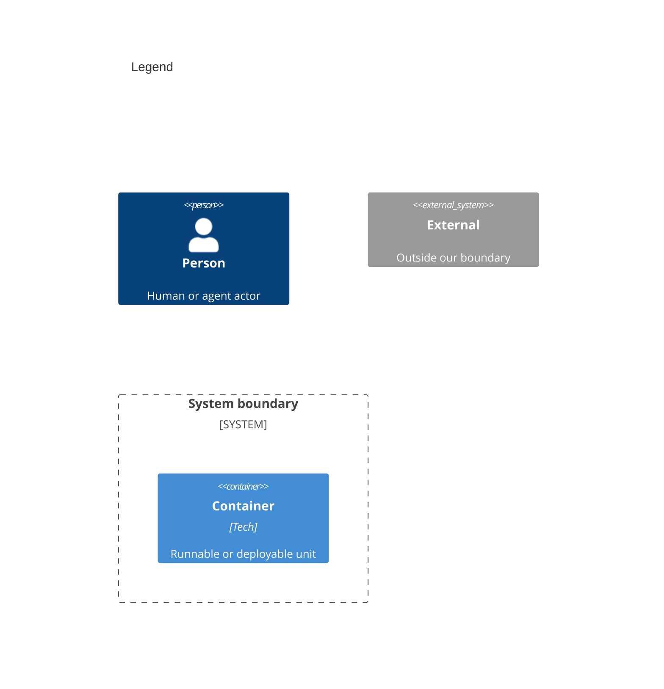

# Containers

<!-- Copy to docs/architecture/02-containers.md. One C4Container diagram: each unit that runs or ships, inside the product's boundary, named for the folder it is built from. Reuse the people and IDs of the system context. -->

<!-- The legend is a second C4Container diagram titled Legend, with one sample of each element kind above. -->

Numbers on nodes and arrows match the callout table.

| #   | Description                              | Why                                     |
| --- | ---------------------------------------- | --------------------------------------- |
| 1   | Same person as the system context.       | Every run starts with this actor.       |
| 2   | The product's boundary.                  | Everything inside it ships from here.   |
| 3   | The app, built from `src/app`.           | One unit per runtime or shipped binary. |
| 4   | Same outside service as the context.     | The product does not own it.            |
| 5   | The user runs the app.                   | The main way in.                        |
| 6   | The app calls the outside service.       | The one dependency it does not own.     |
