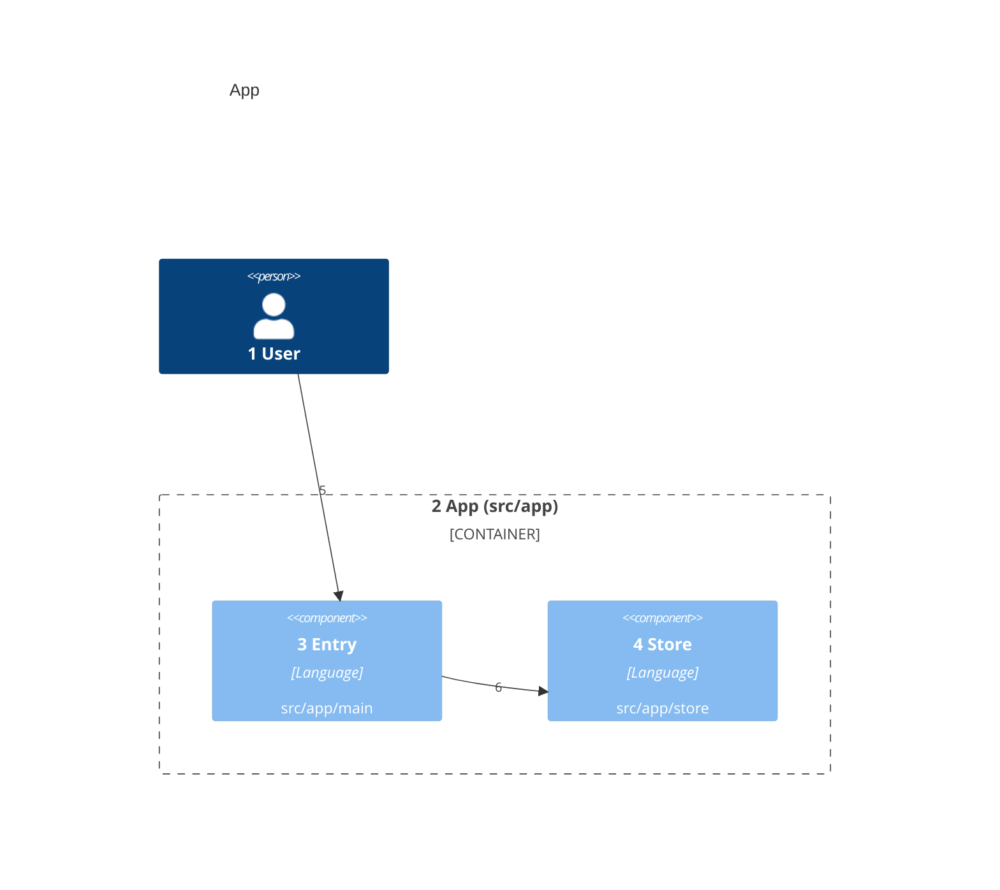
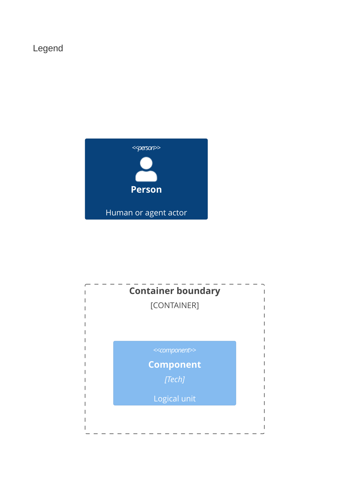

# Components

<!-- Copy to docs/architecture/03-components.md. One C4Component diagram per container: each component inside a boundary, named for the folder it owns. Every product source belongs to exactly one component. -->

<!-- The legend is a second C4Component diagram titled Legend, with one sample of each element kind above. -->

Numbers on nodes and arrows match the callout table.

| #   | Description                          | Why                                      |
| --- | ------------------------------------ | ---------------------------------------- |
| 1   | Same person as the system context.   | Every run starts with this actor.        |
| 2   | The app container, from `src/app`.   | Its components split its sources.        |
| 3   | The entry point in `src/app/main`.   | It takes the user's request.             |
| 4   | The store in `src/app/store`.        | It keeps records for the entry.          |
| 5   | The user calls the entry.            | The main way in.                         |
| 6   | The entry saves through the store.   | One place writes records.                |
