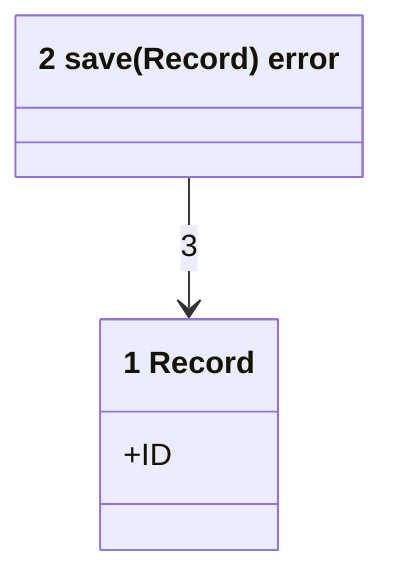
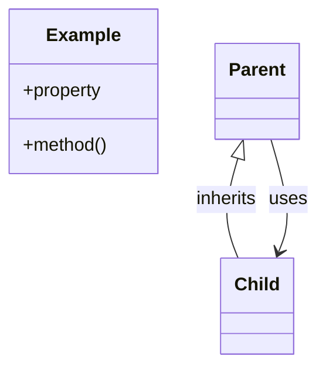

# Code

<!-- Copy to docs/architecture/04-code.md. One classDiagram: the types and functions a reader needs, each labeled with its number and its name in the code, and each arrow a call or reference the code makes. -->

<!-- The legend is a second classDiagram with no numbers, showing each class and arrow kind above. -->

Numbers on classes and relationships match the callout table.

| #   | Description                           | Why                                  |
| --- | ------------------------------------- | ------------------------------------ |
| 1   | One saved record.                     | The type every store call shares.    |
| 2   | Writes one record.                    | The only write path.                 |
| 3   | Save takes the record it writes.      | The call the code makes.             |
