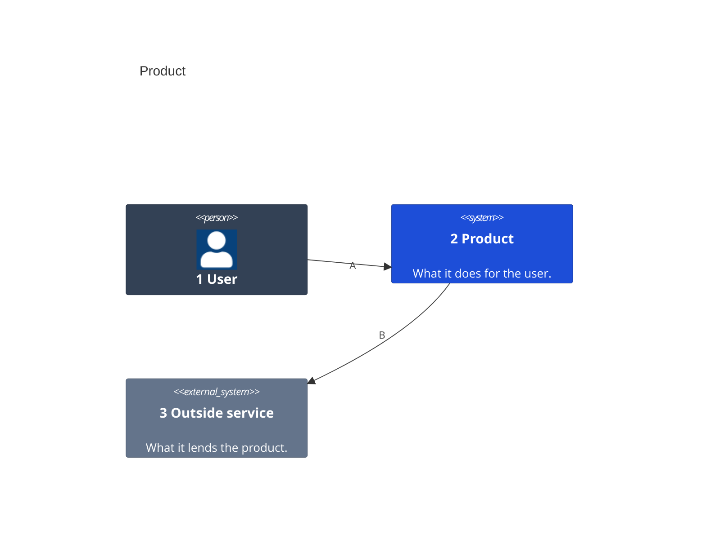
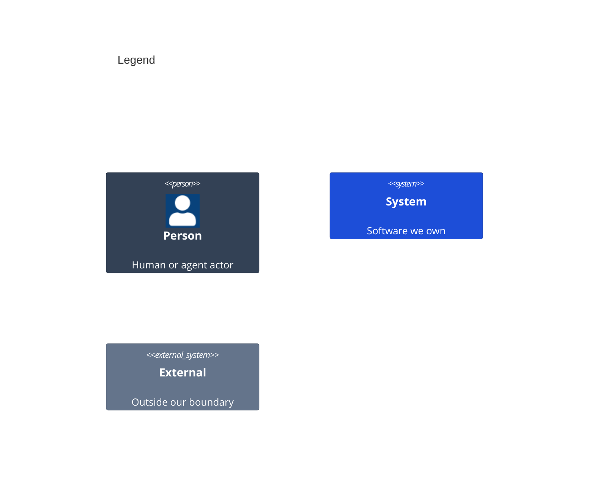

# System Context

<!-- Start docs/architecture/01-system-context.md from this template. One `C4Context` diagram, the only form this level takes: each person and outside system the product meets, and the product as one System. Its kinds are Person, System and `System_Ext`, with their Db and Queue forms. Each element carries the one `UpdateElementStyle` line of its kind below: slate people, blue systems, grey externals, white text. A number opens each label and a letter labels each arrow, A to Z, then AA to ZZ. Each has a row in the callout table. -->

<!-- The legend is a second C4Context diagram titled Legend, with one sample of each element kind above in its own colors. -->

Numbers on nodes and letters on arrows match the callout table.

| #   | Description                         | Why                                       |
| --- | ----------------------------------- | ----------------------------------------- |
| 1   | The person who uses the product.    | Requirements name this actor in a Given.  |
| 2   | The product this repo builds.       | The boundary the other views break down.  |
| 3   | A system the product relies on.     | It sits outside the product's boundary.   |
| A   | The user works in the product.      | The main way in.                          |
| B   | The product calls the outside service. | The one dependency it does not own.    |
