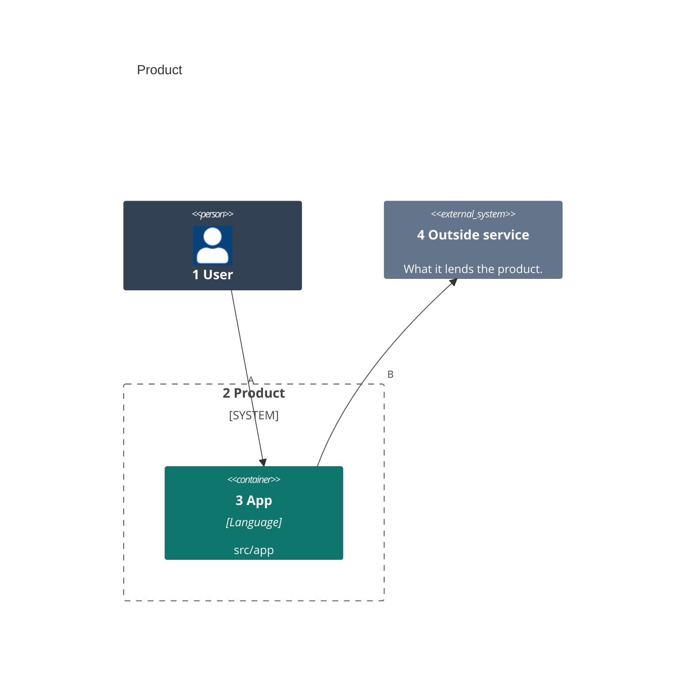
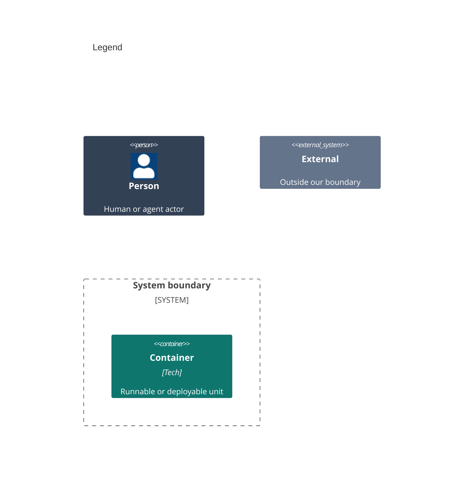

# Containers

<!-- Start docs/architecture/02-containers.md from this template. One `C4Container` diagram, the only form this level takes: each unit that runs or ships, inside the product's `System_Boundary`, named for the folder it is built from, with its technology. Its kinds are Person, `System_Boundary`, Container and `System_Ext`, with their Db and Queue forms. Reuse the people and IDs of the system context. Each element carries the one `UpdateElementStyle` line of its kind below: slate people, teal containers, grey externals, white text, and no style on the boundary. -->

<!-- The legend is a second C4Container diagram titled Legend, with one sample of each element kind above in its own colors. -->

Numbers on nodes and letters on arrows match the callout table.

| #   | Description                              | Why                                     |
| --- | ---------------------------------------- | --------------------------------------- |
| 1   | The person from the system context.      | Every run starts with this actor.       |
| 2   | The product boundary.                    | Everything inside it ships from here.   |
| 3   | The app, built from `src/app`.           | One unit per runtime or shipped binary. |
| 4   | The outside service from the context.    | The product does not own it.            |
| A   | The user runs the app.                   | The main way in.                        |
| B   | The app calls the outside service.       | The one dependency it does not own.     |
