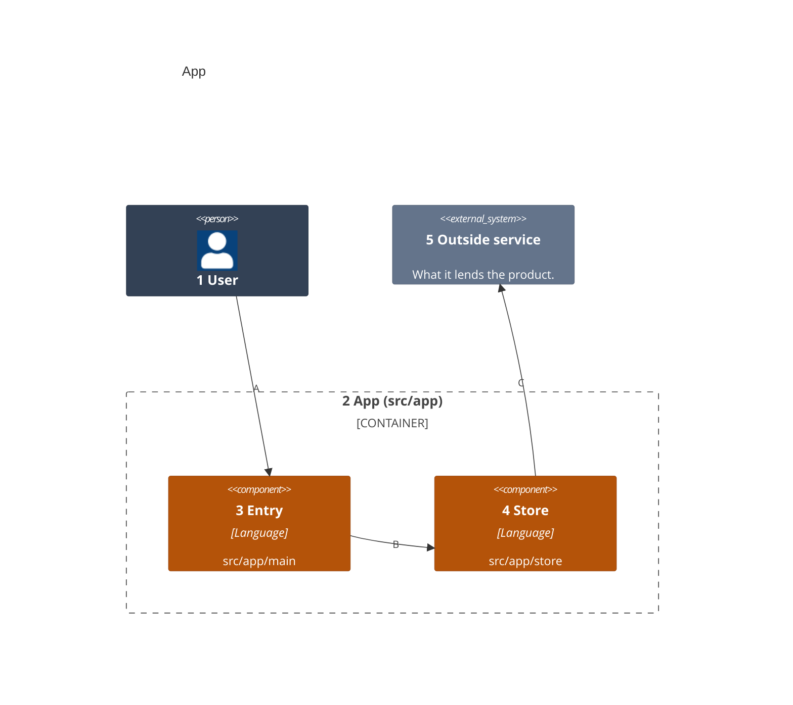
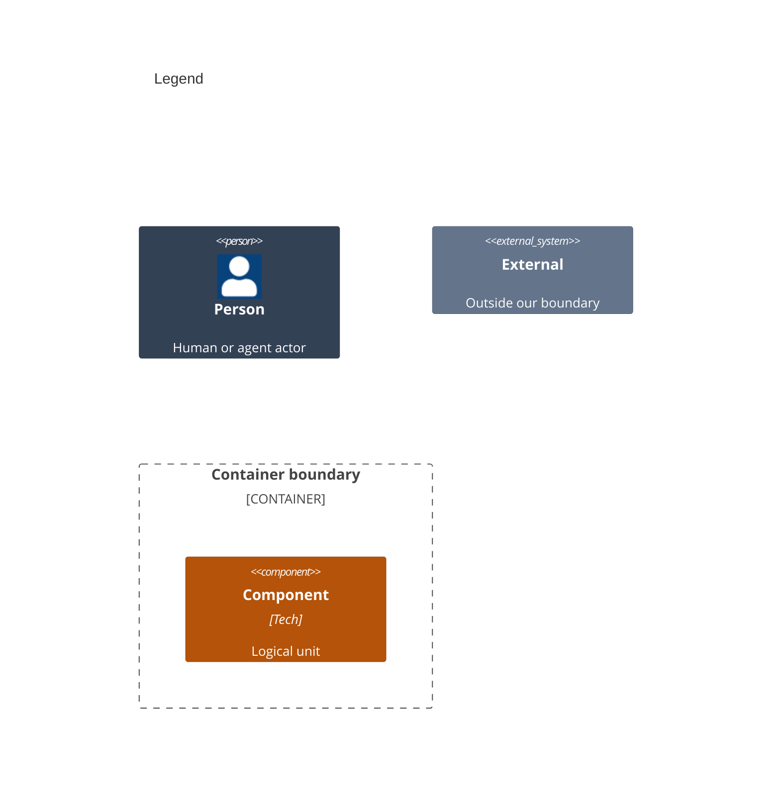

# Components

<!-- Start docs/architecture/03-components.md from this template. One `C4Component` diagram, the only form this level takes: each component inside the `Container_Boundary` of the 02 container it splits, named for the folder it owns, with its technology. Its kinds are Person, `Container_Boundary`, Component and `System_Ext`, with their Db and Queue forms. Every product source belongs to exactly one component. Each element carries the one `UpdateElementStyle` line of its kind below: slate people, amber components, grey externals, white text, and no style on the boundary. -->

<!-- The legend is a second C4Component diagram titled Legend, with one sample of each element kind above in its own colors. -->

Numbers on nodes and letters on arrows match the callout table.

| #   | Description                          | Why                                      |
| --- | ------------------------------------ | ---------------------------------------- |
| 1   | The user who calls the entry.        | Every run starts with this actor.        |
| 2   | The app container, from `src/app`.   | Its components split its sources.        |
| 3   | The entry point in `src/app/main`.   | It takes the user's request.             |
| 4   | The store in `src/app/store`.        | It keeps records for the entry.          |
| 5   | The service the store writes to.     | The call leaves the container here.      |
| A   | The user calls the entry.            | The main way in.                         |
| B   | The entry saves through the store.   | One place writes records.                |
| C   | The store sends records out.         | The one component that calls outside.    |
