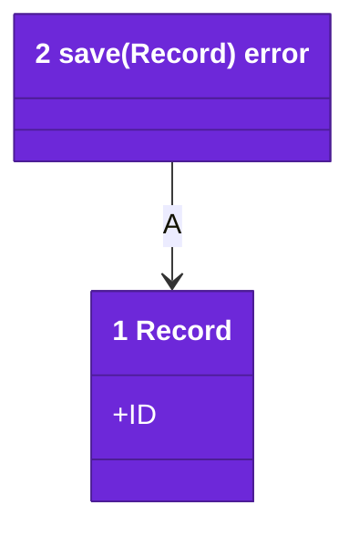
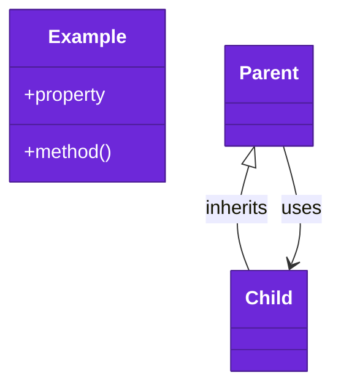

# Code

<!-- Start docs/architecture/04-code.md from this template. One `classDiagram`, the only form this level takes: the types and functions a reader needs, each labeled with its number and its name in the code, and each arrow a call or reference the code makes, labeled with a letter. Each class carries the one violet style line below, with white text; `classDef` and `:::` color nothing here. -->

<!-- The legend is a second classDiagram with no numbers, showing each class and arrow kind above in the same violet. -->

Numbers on classes and letters on relationships match the callout table.

| #   | Description                           | Why                                  |
| --- | ------------------------------------- | ------------------------------------ |
| 1   | One saved record.                     | The type every store call shares.    |
| 2   | Writes one record.                    | The only write path.                 |
| A   | Save takes the record it writes.      | The call the code makes.             |
