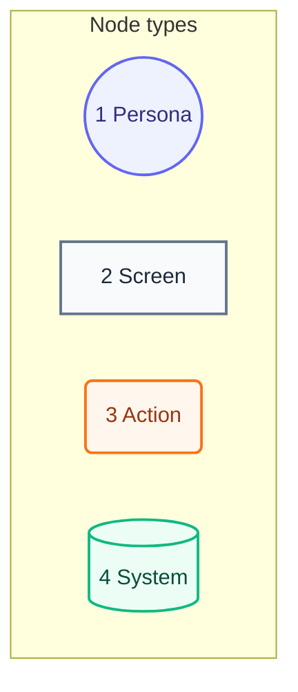
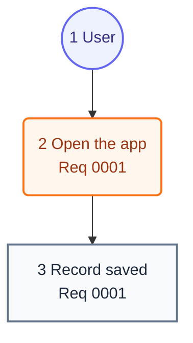

# User Journey

## Legend

<!-- One flowchart sample of each node type the journey uses, styled by the same classes, with its own callout table. -->

Numbers match the callout table.

| #   | Description | Why                                      |
| --- | ----------- | ---------------------------------------- |
| 1   | Persona     | A person the system context declares.    |
| 2   | Screen      | What the person sees.                    |
| 3   | Action      | What the person does.                    |
| 4   | System      | What the product does in reply.          |

## Journey

<!-- One flowchart TB, the only form this level takes: the person's steps from start to result, each node styled by one of the four classes above and no other style. Each label ends with the requirement docs the step fulfils, by ID, and every requirement doc appears on some step. -->

Numbers match the callout table.

| #   | Description          | Type    | Why                                   |
| --- | -------------------- | ------- | ------------------------------------- |
| 1   | The user.            | Persona | Same person as the system context.    |
| 2   | Opens the app.       | Action  | The first step of every visit.        |
| 3   | The record is saved. | Screen  | What the user came to do.             |
